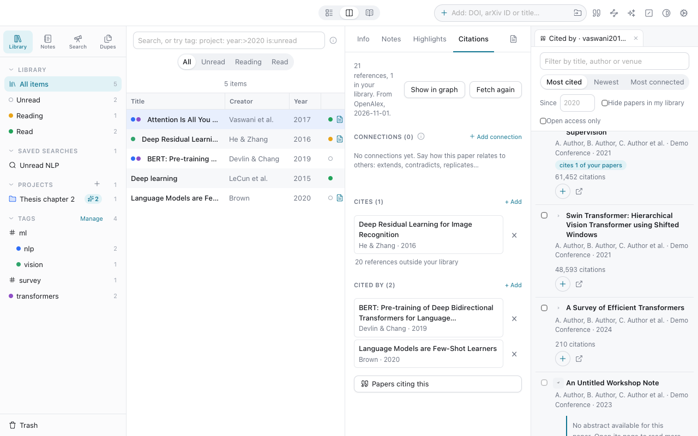
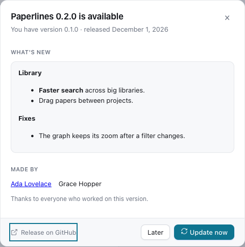

<div align="center">


<h1>Paperlines<br />&#8203;<sup><sub><em>Nanos gigantum humeris insidentes</em></sub></sup></h1>

**Vos articles, vos notes et la façon dont ils se citent, dans une seule app locale.**

Un gestionnaire de références libre et gratuit pour macOS, Windows et Linux : une bibliothèque comme Zotero, des notes comme Obsidian et un graphe des citations comme Connected Papers.

<!-- the release workflow points these buttons at each new version -->
<a href="https://github.com/Paperlines/paperlines/releases/download/v0.1.2/Paperlines_0.1.2_aarch64.pkg"></a> <a href="https://github.com/Paperlines/paperlines/releases/download/v0.1.2/Paperlines_0.1.2_x64-setup.exe"></a> <a href="https://github.com/Paperlines/paperlines/releases/download/v0.1.2/Paperlines_0.1.2_amd64.AppImage"></a>

[](https://github.com/Paperlines/paperlines/releases/latest) [](https://github.com/Paperlines/paperlines/releases) [](https://github.com/Paperlines/paperlines/actions/workflows/ci.yml) [](../../LICENSE) [](https://github.com/Paperlines/paperlines/commits/main) [](https://github.com/Paperlines/paperlines/stargazers)

[**Télécharger**](#download) · [Fonctionnalités](#why-paperlines) · [Ligne de commande et MCP](#command-line-and-ai-assistants) · [FAQ](#questions-people-ask) · [Contribuer](../../.github/CONTRIBUTING.md)

Gratuit · Open source · Sans compte · Sans cloud · Sans télémétrie

[English](../../README.md) · [Español](README.es.md) · **Français** · [Deutsch](README.de.md) · [简体中文](README.zh.md) · [日本語](README.ja.md) · [हिन्दी](README.hi.md)

</div>

<p align="center">
  <picture>
    <source media="(prefers-color-scheme: dark)" srcset="../assets/readme/hero-dark.png" />
    
  </picture>
</p>

<a id="why-paperlines"></a>

## Pourquoi Paperlines

La lecture scientifique se fait à trois endroits à la fois : un gestionnaire de références, une app de notes et une pile de PDF. Paperlines les réunit dans une seule fenêtre, sur votre propre ordinateur.

- **Collecter.** Déposez des PDF, des EPUB ou des dossiers entiers, collez un DOI, un ID arXiv ou PubMed, ou importez du BibTeX, du RIS, du CSL-JSON ou votre bibliothèque Zotero. Les métadonnées sont complétées depuis Crossref et OpenAlex, et vous vérifiez tout avant l’enregistrement.
- **Lire et annoter.** Un lecteur PDF rapide avec des surlignages dans des couleurs qui ont un sens (idée clé, méthode, désaccord…), des soulignements et des sélections de zone. « Citer dans la note » place un surlignage dans votre note avec un lien vers la page.
- **Écrire des notes qui se lient.** Chaque article a sa note ; il y a aussi des notes libres et des notes de projet. Du Markdown avec des `[[liens]]`, des citations `@citekey`, des rétroliens, des tableaux et des formules LaTeX, mis en forme pendant la frappe.
- **Voir comment les articles se relient.** Les listes de références sont récupérées une fois puis mises en cache ; le graphe des citations montre lesquels de *vos* articles citent lesquels, et se met à jour hors ligne à mesure que vous en ajoutez.
- **Citer partout.** Environ 80 styles de citation, des fichiers BibTeX tenus à jour pour LaTeX, et l’export de tout, y compris la bibliothèque entière en un seul dossier.
- **À vous.** Un fichier SQLite et vos PDF, dans un dossier de votre choix. Sauvegardes quotidiennes, restauration en un clic. Rien ne quitte votre ordinateur, sauf les recherches que vous demandez.

## Un graphe des citations pour réfléchir

<p align="center">
  
</p>

- Les articles flottent dans une disposition par forces en direct, comme le graphe d’Obsidian : faites-en glisser un et ses voisins suivent, survolez-le pour faire ressortir ce qu’il cite (bleu) et ce qui le cite (orange).
- Remplis de la couleur du projet, bordés selon le statut de lecture. Des filtres par années, étiquettes, projets, statut, et un graphe local autour d’un article.
- **Articles clés (fil rouge) :** marquez les articles sur lesquels repose un projet, étape par étape. La disposition **Arbre** fait pousser le reste du domaine à partir d’eux ; **Cercle** regroupe tout par projet et par année.
- **Relations typées** selon votre jugement : un article en *prolonge*, en *contredit*, en *reproduit* un autre ou en *applique la méthode*, avec une note et un surlignage comme preuve.

## Trouver quoi lire ensuite

<p align="center">
  
</p>

- **Articles qui le citent :** pour n’importe quel article, les 2 000 travaux les plus cités qui le citent, dans tout OpenAlex. Triez par **plus connectés** pour voir ceux qui citent aussi d’autres articles de votre bibliothèque, souvent les meilleures lectures suivantes.
- **Recherche en ligne** dans OpenAlex, Semantic Scholar, arXiv, PubMed, Crossref, Europe PMC, DataCite et DOAJ à la fois, fusionnée en une seule liste qui signale ce que vous avez déjà. Entièrement gratuit.
- Les doublons sont détectés et fusionnés sans perdre une note ni un surlignage.

## Apportez votre propre assistant IA

<p align="center">
  
</p>

- **Panneau de l’assistant (⌘J) :** discutez avec votre propre Claude Code ou Codex à propos de l’article, du PDF ou de la note ouverts. Il est en lecture seule tant que vous n’autorisez pas les modifications, et chaque changement qu’il fait est affiché.
- **Connexion en un clic** pour Claude Code, Claude Desktop, Codex, Antigravity, Gemini CLI, Grok et Cursor, via le serveur MCP intégré, avec trois compétences : travailler avec vos articles, écrire des notes d’article structurées (chaque point lié à son surlignage dans le PDF) et dénicher les articles qui vous manquent.
- Les suggestions arrivent dans la boîte **Articles suggérés** d’un projet. Rien n’entre dans votre bibliothèque sans votre clic.

<a id="download"></a>

## Télécharger

<!-- the release workflow updates these links to each new version -->
| Plateforme | Installateur | Autres formats |
| --- | --- | --- |
| **macOS**, Apple Silicon (M1 et suivants) | [Paperlines_0.1.2_aarch64.pkg](https://github.com/Paperlines/paperlines/releases/download/v0.1.2/Paperlines_0.1.2_aarch64.pkg) | [.dmg](https://github.com/Paperlines/paperlines/releases/download/v0.1.2/Paperlines_0.1.2_aarch64.dmg) |
| **macOS**, Intel | [Paperlines_0.1.2_x64.pkg](https://github.com/Paperlines/paperlines/releases/download/v0.1.2/Paperlines_0.1.2_x64.pkg) | [.dmg](https://github.com/Paperlines/paperlines/releases/download/v0.1.2/Paperlines_0.1.2_x64.dmg) |
| **Windows** 10/11, x64 | [Paperlines_0.1.2_x64-setup.exe](https://github.com/Paperlines/paperlines/releases/download/v0.1.2/Paperlines_0.1.2_x64-setup.exe) (sans droits administrateur) | [.msi](https://github.com/Paperlines/paperlines/releases/download/v0.1.2/Paperlines_0.1.2_x64_en-US.msi) |
| **Linux**, x86_64 | [Paperlines_0.1.2_amd64.AppImage](https://github.com/Paperlines/paperlines/releases/download/v0.1.2/Paperlines_0.1.2_amd64.AppImage) | [.deb](https://github.com/Paperlines/paperlines/releases/download/v0.1.2/Paperlines_0.1.2_amd64.deb) · [.rpm](https://github.com/Paperlines/paperlines/releases/download/v0.1.2/Paperlines-0.1.2-1.x86_64.rpm) · [CLI](https://github.com/Paperlines/paperlines/releases/download/v0.1.2/paperlines-x86_64-unknown-linux-gnu) |
| **Linux**, aarch64 | [Paperlines_0.1.2_aarch64.AppImage](https://github.com/Paperlines/paperlines/releases/download/v0.1.2/Paperlines_0.1.2_aarch64.AppImage) | [.deb](https://github.com/Paperlines/paperlines/releases/download/v0.1.2/Paperlines_0.1.2_arm64.deb) · [.rpm](https://github.com/Paperlines/paperlines/releases/download/v0.1.2/Paperlines-0.1.2-1.aarch64.rpm) · [CLI](https://github.com/Paperlines/paperlines/releases/download/v0.1.2/paperlines-aarch64-unknown-linux-gnu) |
| **NixOS** | `nix profile install github:Paperlines/paperlines` | voir les notes ci-dessous |

Tous les fichiers sont sur la [page des versions](https://github.com/Paperlines/paperlines/releases/latest). Les paquets Linux nécessitent glibc 2.35 ou plus récent (Ubuntu 22.04, Debian 12, Fedora 36 et suivants).

### Mises à jour, depuis l’app

<p align="center">
  
</p>

Quand une nouvelle version sort, Paperlines vous le signale à la prochaine ouverture : les nouveautés, qui y a travaillé, et **Mettre à jour** ou **Plus tard**. Les mises à jour sont signées et vérifiées avant d’être installées. L’app macOS, les installateurs Windows et l’AppImage se mettent à jour eux-mêmes ; les installations `.deb`, `.rpm` et Nix se mettent à jour via leur gestionnaire de paquets. Désactivez la vérification dans Paramètres → Général ; le mode hors ligne ne vérifie jamais.

<details>
<summary>Notes par plateforme : installateur macOS, Linux, NixOS, COSMIC/Wayland</summary>

**Installateur macOS.** Ouvrez le `.pkg` et suivez les étapes. Il installe Paperlines dans Applications et la commande `paperlines` dans `/usr/local/bin`. Pour désinstaller, supprimez l’app et `/usr/local/bin/paperlines` ; votre bibliothèque reste où elle est.

**Builds macOS non signés.** La première fois, faites un clic droit sur l’app et choisissez **Ouvrir**, puis confirmez. Les builds signés en CI (voir [Signature](../development.md#signing-and-notarization)) s’ouvrent normalement.

**Linux.** Les paquets `.deb` et `.rpm` installent la CLI sous le nom `paperlines`. Pour l’AppImage, placez le fichier séparé `paperlines-<triple>` dans votre PATH, ou utilisez **Paramètres → Ligne de commande → Installer l’outil en ligne de commande**.

**NixOS.** Le dépôt est un flake qui compile l’app et la CLI depuis les sources (x86_64 et aarch64) :

```sh
nix run github:Paperlines/paperlines            # try it
nix profile install github:Paperlines/paperlines
```

Dans une configuration NixOS ou home-manager, ajoutez le flake comme entrée et utilisez son overlay :

```nix
nixpkgs.overlays = [ inputs.paperlines.overlays.default ];
environment.systemPackages = [ pkgs.paperlines ];   # or home.packages
```

Cela installe l’app avec son entrée de bureau et son icône, ainsi que la commande `paperlines`. Remarques :
- Les clés API vont dans le Secret Service. Activez-en un (`services.gnome.gnome-keyring.enable = true;`, ou KeePassXC) ; sans lui, elles sont conservées dans un fichier chiffré.
- L’AppImage ne fonctionne pas telle quelle sous NixOS ; utilisez le flake (ou `appimage-run`).

**COSMIC (et autres bureaux Wayland).** Conçu pour COSMIC, mais pas encore testé dessus : vos retours sont les bienvenus.
- Le mode clair/sombre suit le réglage du bureau (lu depuis le portail de bureau XDG, qu’utilisent COSMIC, GNOME et KDE), y compris quand il change pendant que l’app est ouverte. C’est ce que signifie le thème **Système** dans les Paramètres.
- La fenêtre a un véritable app ID : le dock affiche la bonne icône et regroupe la fenêtre avec son lanceur.
- Avec le pilote NVIDIA sous Wayland, le moteur de rendu DMA-BUF de WebKitGTK est désactivé automatiquement (il y affiche une fenêtre vide). Définissez `WEBKIT_DISABLE_DMABUF_RENDERER=0` pour le garder actif.
- Les boîtes de dialogue de fichiers sont celles de GTK. La fenêtre n’a ni barre de titre ni barre de menus système : la barre supérieure de Paperlines porte les boutons de la fenêtre, et on la fait glisser pour déplacer la fenêtre.

</details>

<a id="command-line-and-ai-assistants"></a>

## Ligne de commande et assistants IA

La commande `paperlines` travaille sur la même bibliothèque que l’app. Le `.pkg` macOS l’installe ; ailleurs, utilisez **Paramètres → Ligne de commande → Installer l’outil en ligne de commande**.

<details>
<summary>Commandes</summary>

Le `.pkg` macOS l’installe pour vous. Sinon, utilisez **Paramètres → Ligne de commande → Installer l’outil en ligne de commande**. Sous macOS, cela lie la CLI fournie avec l’app dans `~/.local/bin/paperlines`. Ensuite :

```sh
paperlines search 'tag:ml year:>=2020 attention'
paperlines show vaswani2017attention          # metadata, counts and the paper note
paperlines note devlin2019bert --add 'Masked LM pre-training'
paperlines cites devlin2019bert               # library papers it cites (also: cited-by)
paperlines add paper.pdf 10.1038/nature14539 refs.bib --fetch-refs
paperlines export -f bibtex --project Thesis -o thesis.bib
paperlines export-notes ~/notes-export
paperlines fetch-refs                         # every paper without a reference list
paperlines doctor [--fix]                     # integrity, files, edges, search index
paperlines backup [--list | --restore FILE --yes]
paperlines cite vaswani2017attention --style ieee   # -b for a reference list; `paperlines styles` lists styles
paperlines rm KEY... / paperlines trash [list | restore KEY... | empty [--older-than DAYS]]
paperlines citing vaswani2017attention -s connected   # papers anywhere citing it (also: cited, newest)
paperlines relate chen2022 extends smith2021 --note "same loss"   # also: unrelate, relations [KEY], relation-types
paperlines duplicates [--merge | --dismiss]
paperlines find-pdf [KEY...]                  # open-access PDFs via OpenAlex
paperlines import-zotero [~/Zotero] / paperlines import-dump library.json
paperlines auto-export add -f bibtex thesis.bib [--project Thesis]
paperlines paths [--set-library DIR]
```

Chaque commande accepte `--json`. `--library DIR` ou `PAPERLINES_LIBRARY=DIR` sélectionne une autre bibliothèque. La CLI, l’app et le serveur MCP partagent une seule implémentation (`crates/ops`), leurs résultats sont donc identiques.

</details>

<details>
<summary>Serveur MCP pour Claude Code, Claude Desktop et d’autres</summary>

```sh
claude mcp add paperlines -- paperlines mcp
```

Claude Desktop : ajoutez ceci à `claude_desktop_config.json` :

```json
{ "mcpServers": { "paperlines": { "command": "paperlines", "args": ["mcp"] } } }
```

Outils : `search_library`, `get_item`, `get_paper_note`, `list_citations`, `find_citing_papers`, `list_relations`, `export_bibliography` (tous en lecture seule ; `find_citing_papers` utilise le réseau sauf si sa réponse est en cache), `add_bullet` (ajoute un point à une note d’article) et `add_relation` (enregistre une relation typée demandée par l’utilisateur). Le serveur ne communique que par stdin et stdout.

</details>

<a id="questions-people-ask"></a>

## Questions fréquentes

<details>
<summary>Faut-il un compte ? Quelque chose part-il dans le cloud ?</summary>

Pas de compte, pas de cloud, pas de télémétrie. La bibliothèque est un dossier sur votre ordinateur. Les seules requêtes réseau sont les recherches de métadonnées, de références et d’articles citants (Crossref, OpenAlex, Semantic Scholar, arXiv) quand vous ajoutez des articles ou les demandez, qui envoient des identifiants comme un DOI, et une requête à GitHub à l’ouverture de l’app, pour savoir si une nouvelle version est sortie. **Paramètres → Mode hors ligne** désactive tout cela.

</details>

<details>
<summary>Puis-je quitter Zotero ?</summary>

Oui. **Ajouter → Importer depuis Zotero** apporte les articles avec leurs PDF, collections (en projets), étiquettes, notes et surlignages. La base de données de Zotero est d’abord copiée et jamais modifiée : vous pouvez continuer à utiliser les deux.

</details>

<details>
<summary>Où sont mes données, et comment les sauvegarder ?</summary>

| | macOS | Linux |
| --- | --- | --- |
| Bibliothèque (base de données, `pdfs/`, `backups/` ; déplaçable dans **Paramètres → Bibliothèque**) | `~/Library/Application Support/Paperlines/` | `$XDG_DATA_HOME/paperlines/` (par défaut `~/.local/share/paperlines/`) |
| Configuration (repli pour les clés API) | `~/Library/Application Support/Paperlines/` | `$XDG_CONFIG_HOME/paperlines/` |
| Cache | `~/Library/Caches/Paperlines/` | `$XDG_CACHE_HOME/paperlines/` |

- **La bibliothèque** est un fichier SQLite (WAL, FTS5) plus des PDF stockés par empreinte de contenu. Les fichiers d’origine sont copiés, jamais modifiés.
- **Dossiers cloud.** Si vous gardez la bibliothèque dans iCloud Drive ou Dropbox, quittez l’app avant la synchronisation. Un client cloud ne doit pas synchroniser une base SQLite ouverte.
- **Clés API.** Les clés (Semantic Scholar et OpenAlex, toutes deux facultatives) vont dans le trousseau macOS ou le Secret Service de Linux. Sans Secret Service, elles vont dans un fichier chiffré du dossier de configuration.

Une sauvegarde est faite chaque jour et avant chaque mise à niveau ; **Paramètres → Bibliothèque** en restaure une en un clic, et `paperlines backup` fait de même depuis un terminal.

</details>

<details>
<summary>Fonctionne-t-il avec LaTeX ?</summary>

Oui. Copiez des citations dans environ 80 styles, exportez en BibTeX, CSL-JSON ou RIS, et utilisez **Garder ce fichier à jour** pour réécrire un fichier `.bib` à chaque changement de la bibliothèque, comme Better BibTeX.

</details>

<details>
<summary>Tout ce que fait Paperlines</summary>

- **Bibliothèque.** Ajoutez des articles en déposant des PDF, des EPUB ou des dossiers, ou à partir de DOI, d’ID arXiv et de fichiers BibTeX, RIS ou CSL-JSON. Comme dans Zotero, chaque fichier est listé par titre et auteur, pas par nom de fichier. Les métadonnées viennent du fichier (infos PDF, données du paquet EPUB) et sont complétées via Crossref ou OpenAlex. Un PDF sans DOI est identifié par le texte de sa première page. Vous vérifiez tout avant l’enregistrement. La bibliothèque est un tableau triable (titre, auteur, année, date d’ajout), et tous les champs de type Zotero sont modifiables : volume, numéro, pages, éditeur, lieu, ISBN/ISSN, édition, collection et directeurs de publication.
- **Import depuis Zotero.** Apporte les articles avec leurs PDF, collections (en projets), étiquettes, notes et surlignages. La base de données de Zotero est d’abord copiée et jamais modifiée. Un export JSON de cette app s’importe aussi.
- **Doublons et Corbeille.** Une vue Doublons trouve les articles ayant le même PDF, ou presque le même titre la même année. Fusionnez-les en un seul, en gardant chaque note, surlignage, étiquette et fichier. Supprimer met les articles à la Corbeille (avec Annuler) ; elle se vide d’elle-même au bout de 30 jours (configurable).
- **Recherche.** La recherche plein texte couvre les titres, auteurs, résumés, notes et surlignages, avec des qualificatifs : `tag:ml/nlp project:"Thesis" author:hinton year:>=2020 is:unread has:pdf cites:<citekey> cited-by:<citekey>`, et `-` exclut un terme. Les recherches peuvent être enregistrées.
- **Organiser.** Des étiquettes colorées et hiérarchiques (renommage et fusion), des projets, un statut de lecture, des évaluations et une palette de commandes (⌘K / Ctrl+K).
- **Lire.** Un lecteur PDF.js avec surlignages, soulignements et sélections de zone. Les couleurs de surlignage portent un sens (jaune = idée clé, etc.). « Citer dans la note » copie un surlignage dans la note de l’article avec un lien vers la page. « Exporter le PDF annoté » écrit une copie ; l’original n’est jamais modifié.
- **Ajout rapide.** Collez un DOI, un ID arXiv ou PubMed, ou un titre dans le champ de la barre supérieure et appuyez sur Enter pour le vérifier et l’ajouter ; le bouton à son extrémité propose les autres moyens (fichiers, dossiers, BibTeX, Zotero, un export de bibliothèque, la recherche en ligne).
- **Notes d’article.** Chaque article a une note. Son en-tête (titre, auteurs, dates) est généré à partir de l’article ; le corps, ce sont vos points. Les notes sont en Markdown avec des `[[liens]]` vers d’autres notes et articles (taper `[[` les suggère, et propose une nouvelle note quand rien ne correspond ; suivre le lien crée la note), des `@citekey`, des formules et des rétroliens. Les formules sont en LaTeX : `$…$` en ligne et `$$…$$` pour une formule centrée, y compris sur plusieurs lignes, affichées avec KaTeX. Dans une formule, taper `\` complète les commandes avec leur symbole (`\al` → `\alpha` α), et la barre d’outils de l’éditeur propose titres et intertitres, gras, italique, barré et code, listes à puces, numérotées et de tâches, et citations (avec des raccourcis : ⌘B, ⌘I, ⌘E, ⌘⇧X, ⌘⇧8/7/9, ⌘⌥1–3 ; chaque bouton bascule, et Enter poursuit une liste), un bouton de lien, des boutons de formule en ligne et en bloc, et une palette **Ω** de lettres grecques, d’opérateurs, de relations, de flèches, de symboles d’ensembles et de logique, et d’accents. L’aperçu en direct fonctionne comme dans Obsidian : le Markdown et les formules s’affichent pendant la frappe, sauf là où vous écrivez. Les notes libres et les notes de projet fonctionnent de la même façon.
- **Recherche en ligne.** Une seule recherche dans OpenAlex, Semantic Scholar, arXiv, PubMed, Crossref, Europe PMC (sciences de la vie, avec texte intégral gratuit), DataCite (jeux de données, logiciels et prépublications) et DOAJ (revues en libre accès), fusionnée en une seule liste classée ; activez ou désactivez les sources, voyez quels articles vous avez déjà, et cartographiez les résultats dans un graphe de projet. Entièrement gratuit ; seuls OpenAlex et Semantic Scholar acceptent une clé facultative.
- **Graphe des citations.** Les listes de références sont récupérées une fois (OpenAlex, puis Semantic Scholar, ou votre propre serveur GROBID) et mises en cache ; OpenCitations, un index de citations ouvert, ajoute les références qu’ils ont manquées et prend le relais quand aucun des deux ne connaît un article. Seuls les articles de votre bibliothèque apparaissent dans le graphe. Les articles ajoutés plus tard sont liés hors ligne depuis le cache. Vous pouvez ajouter ou retirer des liens à la main, et le recalcul respecte ces décisions.
- **Vue en graphe, comme celle d’Obsidian.** Les articles sont des boîtes arrondies étiquetées par premier auteur et année (« Smith ’21 »), ou des points à la manière d’Obsidian. Une disposition par forces en direct : les articles flottent puis se stabilisent, en faire glisser un entraîne ses voisins, les libellés apparaissent au fil du zoom, et le survol fait ressortir les citations d’un article (bleu : il cite, orange : le cite) et estompe le reste. Les articles sont remplis de la couleur de leur projet et bordés selon le statut de lecture ; la sélection et le focus clavier dessinent un contour autour de la boîte, et une petite légende sur le canevas explique les couleurs. L’engrenage ancre des réglages à la Obsidian à côté du graphe (en l’élargissant d’abord si le panneau est étroit) : **Filtres** (recherche, articles sans lien, années, étiquette, projet, statut, graphe local autour de l’article sélectionné), **Groupes** (couleur par projet, étiquette ou statut ; anneau de statut ; légende), **Affichage** (boîtes ou points, disposition par forces ou par année, libellés, flèches, estompage du texte, taille des nœuds, épaisseur des liens, vue d’ensemble) et **Forces** (centrale, répulsion, force des liens, distance des liens). Survoler un article affiche sa fiche de note ; cliquez pour l’épingler et la modifier ; un double-clic ou Enter ouvre le PDF.
- **Relations typées.** Notez comment les articles se relient, selon votre jugement : l’un en *prolonge*, en *contredit*, en *reproduit* un autre ou en *applique la méthode*, ou un type que vous définissez (par ex. *soutient* / *soutenu par*). Chaque relation se lit correctement depuis les deux articles (« Prolonge » / « Prolongé par »), peut porter une note et un surlignage PDF comme preuve, et apparaît dans le graphe comme un lien coloré et étiqueté, filtrable par type. Ajoutez-les depuis l’onglet Citations d’un article, le menu contextuel, ⌘K, ou dans le graphe en faisant glisser avec ⌥ d’un article vers un autre. Aussi `paperlines relate chen2022 extends smith2021` et les outils MCP `list_relations` / `add_relation`.
- **Articles qui le citent.** Pour tout article ayant un DOI ou un ID arXiv, voyez qui le cite, dans tout OpenAlex (Semantic Scholar en secours) : les 2 000 plus cités, triables par citations, date ou **plus connectés**, c’est-à-dire les articles qui citent aussi d’autres articles de votre bibliothèque, souvent les meilleures lectures suivantes. Filtrez, repérez ceux qui sont déjà dans votre bibliothèque, et ajoutez ceux que vous voulez via la vérification d’import. Conservé une semaine ; `paperlines citing` et le serveur MCP font de même.
- **Articles clés (fil rouge).** Marquez les articles sur lesquels repose un projet, étape par étape : l’idée, puis ce qui s’est construit dessus. Une étape peut contenir plusieurs articles (deux équipes qui ont trouvé la même chose en même temps). Construisez-le dans la fenêtre du projet ou par un clic droit sur un article → *Ajouter au fil rouge*. Le graphe dessine les articles clés en boîtes ambrées numérotées par étape (①, ②…), reliées par un chemin doré. Deux autres dispositions l’utilisent : **Arbre** pousse de gauche à droite à partir du fil rouge, chaque étape étant une boîte nommée sur le tronc et chaque autre article étant suspendu à l’article clé dont il est le plus proche ; **Cercle** place tous les articles sur un anneau, regroupés par projet et ordonnés par année (des points au-delà de 150 articles). Aussi `paperlines spine "Thesis" add smith2018 --step 1`.
- **Panneau de l’assistant.** ⌘J (ou le bouton de l’assistant) ouvre une discussion avec votre propre **Claude Code** ou **Codex**, connecté avec votre propre compte : aucune clé API à configurer. Le panneau propose les agents que vous avez connectés dans Paramètres ▸ Assistants IA ; passez de l’un à l’autre depuis son en-tête (changer d’agent démarre une nouvelle discussion). Il ne voit que votre bibliothèque Paperlines, via les mêmes outils que le serveur MCP. Il sait quel article, PDF ou note vous avez ouvert et suggère des questions à poser à son sujet. Ses étapes se replient en une ligne que vous pouvez déplier, et les liens `@citekey` et vers les surlignages dans ses réponses ouvrent l’article ou la page. Il est en **Lecture seule** jusqu’à ce que vous le passiez en **Peut modifier** ; il peut alors écrire des notes, des surlignages, des relations et des suggestions (il ne supprime jamais rien), et chaque changement qu’il fait est affiché dans la discussion.
- **Apparence.** Paramètres ▸ Apparence : thème, couleur d’accent (bleu canard, bleu, violet, vert, ambre, rose), disposition (barre latérale et assistant de chaque côté : Classique, Inversée, tous deux à gauche, tous deux à droite), icônes fines ou normales, et libellés facultatifs sous les icônes de la barre supérieure.
- **Assistants IA.** Paramètres → Assistants IA connecte le serveur MCP intégré à Claude Code, Claude Desktop, Codex, Antigravity, Gemini CLI, Grok et Cursor en un clic (en modifiant la configuration propre à chaque assistant, ou via sa commande `mcp add`, sans toucher au reste), et installe trois compétences : **paperlines** (travailler avec vos articles), **paperlines-notes** (écrire des notes d’article dans votre format Idée clé / Méthode / Pourquoi c’est important, ou argument par argument : elle surligne dans le PDF la phrase derrière chaque argument, dans la couleur correspondant à son sens, et lie chaque point de la note à son surlignage ; aussi des synthèses de projet et des brouillons d’état de l’art ; elle montre le texte et demande avant d’enregistrer, et n’écrase jamais rien) et **paperlines-scout** (trouver les articles qui vous manquent). L’assistant voit vos projets et le sujet de votre bibliothèque, lit le PDF d’un article, surligne des passages en les citant (le lecteur les place sur la page la prochaine fois que le PDF est ouvert), et peut créer des notes ou les compléter. L’app prend en compte ses changements chaque fois que sa fenêtre revient au premier plan. Demandez-lui quoi lire ensuite : il suggère des articles avec leurs raisons (cités par plusieurs articles de votre projet, en citant plusieurs, connexes, ou correspondant à un sujet) et les place dans la boîte **Articles suggérés** du projet, où vous ajoutez ou écartez chacun ; rien n’entre dans votre bibliothèque sans votre clic, et les articles écartés ne reviennent jamais. Aussi `paperlines suggest --project NAME [--topic …] [--post]` et `paperlines projects`.
- **Onglets et dispositions.** Les PDF, les notes et le graphe s’ouvrent dans des onglets. Trois dispositions : bibliothèque seule, bibliothèque avec lecteur, et lecteur seul.
- **Citer.** Copiez une citation (⌘⇧C) ou une entrée bibliographique (⌘⇧B) dans l’un des quelque 80 styles CSL intégrés (APA, Chicago, IEEE, Nature, Vancouver…). Elle se colle en texte enrichi dans Word ou Google Docs. **Trouver un PDF en libre accès** récupère une copie légale via OpenAlex.
- **Export.** BibTeX, CSL-JSON, RIS, une liste de références Markdown, une bibliographie mise en forme (HTML, dans n’importe quel style) et un dossier de notes Markdown. **Bibliothèque entière** écrit un seul dossier, `library.json` plus `pdfs/`, avec tout : les articles et leurs PDF, les notes, les surlignages, les étiquettes, les projets avec leurs couleurs et articles clés, le graphe des citations (y compris les liens définis à la main) et les relations typées avec leurs preuves. **Ajouter ▸ Importer une bibliothèque…** l’intègre dans une autre bibliothèque (sur un autre ordinateur, ou fusionnée dans une bibliothèque existante : les articles déjà présents sont ignorés). Aussi `paperlines export-library DIR` et `paperlines import-dump FOLDER`. **Garder ce fichier à jour** réécrit un fichier `.bib` (ou autre) à chaque changement de la bibliothèque, comme Better BibTeX, pour que les projets LaTeX restent à jour.
- **De l’aide là où il en faut.** Les boutons ⓘ dans les Paramètres et à côté de la recherche, de la Corbeille et des Doublons expliquent chaque option.
- **Sécurité.** Une sauvegarde quotidienne avec restauration en un clic, une sauvegarde avant chaque mise à niveau du schéma, des transactions partout, et `doctor`.
- **Ligne de commande et MCP.** La CLI `paperlines`, et un serveur MCP pour que Claude Code ou Claude Desktop puissent chercher dans votre bibliothèque et ajouter des points aux notes d’article. Il fonctionne en local via stdio, jamais sur le réseau.

Le seul accès réseau concerne les recherches de métadonnées, de références et d’articles citants (Crossref, OpenAlex, Semantic Scholar, arXiv), et seulement quand vous ajoutez des articles ou les demandez, plus une requête à GitHub à l’ouverture de l’app pour savoir si une nouvelle version est sortie (Paramètres → Général permet de la désactiver). Seuls des identifiants (DOI, ID arXiv) sont envoyés. Une clé API OpenAlex gratuite (Paramètres → Citations) vous donne votre propre quota quotidien ; sans elle, les recherches partagent un petit quota avec votre réseau. **Paramètres → Mode hors ligne** désactive tout cela.

</details>

## Compiler depuis les sources

Prérequis :

- Node 26+, pnpm 12.21 (version exacte dans `package.json`), Rust via rustup (version fixée dans `rust-toolchain.toml`)
- **macOS :** Xcode Command Line Tools (`xcode-select --install`)
- **Debian/Ubuntu :** `sudo apt install libwebkit2gtk-4.1-dev libgtk-3-dev libayatana-appindicator3-dev librsvg2-dev libsecret-1-dev patchelf build-essential curl file`
- **Fedora :** `sudo dnf install webkit2gtk4.1-devel gtk3-devel libappindicator-gtk3-devel librsvg2-devel libsecret-devel openssl-devel`
- **Arch :** `sudo pacman -S webkit2gtk-4.1 gtk3 libappindicator-gtk3 librsvg libsecret base-devel`

```sh
pnpm install
pnpm tauri dev        # run the app (builds the CLI sidecar first)
pnpm tauri build      # macOS: .app + .dmg; Linux: .deb, .rpm, AppImage
pnpm build:pkg        # macOS: the .pkg installer, from the .app built above
```

Pour un build macOS universel, lancez `rustup target add x86_64-apple-darwin aarch64-apple-darwin`, puis `pnpm tauri build --target universal-apple-darwin`.

Les vérifications, l’architecture et les conventions sont décrites dans [docs/development.md](../development.md) et [docs/architecture.md](../architecture.md).

## En savoir plus

- [Nouveautés](../CHANGELOG.md) : les changements de chaque version
- [Développement](../development.md) : vérifications, versions, signature, Nix, Windows, renommage
- [Architecture](../architecture.md) : comment le code est organisé, et pourquoi
- [Contribuer](../../.github/CONTRIBUTING.md) : comment aider

## Communauté

Les rapports de bugs, les idées et les pull requests sont les bienvenus : [ouvrez un ticket](https://github.com/Paperlines/paperlines/issues) ou lisez [CONTRIBUTING.md](../../.github/CONTRIBUTING.md) pour commencer. Merci à toutes les personnes qui ont contribué :

<a href="https://github.com/Paperlines/paperlines/graphs/contributors"></a>

Si Paperlines aide vos recherches, une ⭐ sur GitHub aide d’autres chercheurs à le trouver.

## Citer Paperlines

<details>
<summary>BibTeX</summary>

```bibtex
@software{paperlines,
  author  = {{The Paperlines contributors} and Yoav Yosif-Or},
  title   = {{Paperlines}: a local-first reference manager},
  year    = {2026},
  url     = {https://github.com/Paperlines/paperlines},
  license = {AGPL-3.0-or-later}
}
```

**Aide et à propos → Citer Paperlines** dans l’app donne l’entrée avec votre version exacte, ainsi qu’en APA.

</details>

## Licence

Copyright © 2026 les contributeurs de Paperlines et Yoav Yosif-Or. Paperlines est un logiciel libre sous [GNU Affero General Public License v3.0 ou ultérieure](../../LICENSE) : vous pouvez l’utiliser, l’étudier, le partager et le modifier, et si vous distribuez une version modifiée (y compris en la faisant tourner comme service réseau), vous devez partager vos modifications sous la même licence.

<sub>Claude, Codex, Gemini, Antigravity, Grok et Cursor sont des marques de leurs propriétaires respectifs. Leurs noms et icônes n’apparaissent que pour indiquer les outils avec lesquels Paperlines fonctionne, et non comme une caution. Les icônes des assistants proviennent de [Lobe Icons](https://github.com/lobehub/lobe-icons) (licence MIT, voir `src/assets/agents/LICENSE-lobe-icons.txt`).</sub>

---

<p align="center">
  Créé par <a href="https://github.com/yoav-yosifor"><strong>Yoav Yosif-Or</strong></a>
</p>
