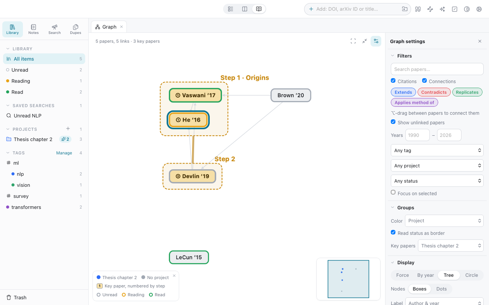

<div align="center">


<h1>Paperlines<br />&#8203;<sup><sub><em>Nanos gigantum humeris insidentes</em></sub></sup></h1>

**आपके पेपर, आपके नोट और वे एक-दूसरे को कैसे उद्धृत करते हैं, सब एक लोकल ऐप में।**

macOS, Windows और Linux के लिए एक मुफ़्त, ओपन-सोर्स रेफ़रेंस मैनेजर: Zotero जैसी लाइब्रेरी, Obsidian जैसे नोट, और Connected Papers जैसा उद्धरण ग्राफ़।

<!-- the release workflow points these buttons at each new version -->
<a href="https://github.com/Paperlines/paperlines/releases/download/v0.1.3/Paperlines_0.1.3_aarch64.pkg"></a> <a href="https://github.com/Paperlines/paperlines/releases/download/v0.1.3/Paperlines_0.1.3_x64-setup.exe"></a> <a href="https://github.com/Paperlines/paperlines/releases/download/v0.1.3/Paperlines_0.1.3_amd64.AppImage"></a>

[](https://github.com/Paperlines/paperlines/releases/latest) [](https://github.com/Paperlines/paperlines/releases) [](https://github.com/Paperlines/paperlines/actions/workflows/ci.yml) [](../../LICENSE) [](https://github.com/Paperlines/paperlines/commits/main) [](https://github.com/Paperlines/paperlines/stargazers)

[**डाउनलोड**](#download) · [विशेषताएँ](#why-paperlines) · [कमांड लाइन और MCP](#command-line-and-ai-assistants) · [सामान्य प्रश्न](#questions-people-ask) · [योगदान](../../.github/CONTRIBUTING.md)

मुफ़्त · ओपन सोर्स · कोई खाता नहीं · कोई क्लाउड नहीं · कोई टेलीमेट्री नहीं

[English](../../README.md) · [Español](README.es.md) · [Français](README.fr.md) · [Deutsch](README.de.md) · [简体中文](README.zh.md) · [日本語](README.ja.md) · **हिन्दी**

</div>

<p align="center">
  <picture>
    <source media="(prefers-color-scheme: dark)" srcset="../assets/readme/hero-dark.png" />
    
  </picture>
</p>

<a id="why-paperlines"></a>

## Paperlines क्यों

शोध-पठन एक साथ तीन जगहों पर होता है: एक रेफ़रेंस मैनेजर, एक नोट ऐप और PDF का एक ढेर। Paperlines इन्हें एक ही विंडो में, आपके अपने कंप्यूटर पर ले आता है।

- **इकट्ठा करें।** PDF, EPUB या पूरे फ़ोल्डर छोड़ें, कोई DOI, arXiv या PubMed ID पेस्ट करें, या BibTeX, RIS, CSL-JSON या अपनी Zotero लाइब्रेरी इम्पोर्ट करें। मेटाडेटा Crossref और OpenAlex से पूरा किया जाता है, और सहेजे जाने से पहले आप सब कुछ जाँच लेते हैं।
- **पढ़ें और एनोटेट करें।** एक तेज़ PDF रीडर, जिसमें हाइलाइट के रंगों का कुछ अर्थ होता है (मुख्य विचार, पद्धति, असहमति…), साथ में रेखांकन और क्षेत्र-चयन। "नोट में उद्धृत करें" किसी हाइलाइट को पेज की ओर वापस लिंक के साथ आपके नोट में डाल देता है।
- **ऐसे नोट लिखें जो आपस में जुड़ें।** हर पेपर का एक नोट होता है; स्वतंत्र नोट और प्रोजेक्ट नोट भी। Markdown, जिसमें `[[links]]`, `@citekey` उद्धरण, बैकलिंक, तालिकाएँ और LaTeX गणित हैं, जो लिखते-लिखते रेंडर होते हैं।
- **देखें कि पेपर कैसे जुड़े हैं।** संदर्भ सूचियाँ एक बार लाई जाती हैं और कैश हो जाती हैं; उद्धरण ग्राफ़ दिखाता है कि *आपके* कौन-से पेपर किन्हें उद्धृत करते हैं, और जैसे-जैसे आप और जोड़ते हैं, ऑफ़लाइन अपडेट होता रहता है।
- **कहीं भी उद्धृत करें।** लगभग 80 उद्धरण शैलियाँ, LaTeX के लिए हमेशा अपडेट रहने वाली BibTeX फ़ाइलें, और हर चीज़ का एक्सपोर्ट, जिसमें पूरी लाइब्रेरी एक फ़ोल्डर के रूप में भी शामिल है।
- **आपका अपना।** एक SQLite फ़ाइल और आपके PDF, आपके चुने हुए फ़ोल्डर में। रोज़ाना बैकअप, एक क्लिक में बहाली। आपके माँगे गए लुकअप के अलावा कुछ भी आपके कंप्यूटर से बाहर नहीं जाता।

## एक उद्धरण ग्राफ़ जिसके साथ आप सोच सकें

<p align="center">
  
</p>

- पेपर एक लाइव फ़ोर्स लेआउट में तैरते हैं, Obsidian के ग्राफ़ की तरह: किसी एक को खींचें तो उसके पड़ोसी पीछे-पीछे आते हैं, होवर करें तो वह जिन्हें उद्धृत करता है (नीला) और जो उसे उद्धृत करते हैं (नारंगी) वे चमक उठते हैं।
- प्रोजेक्ट के रंग से भरे, पढ़ने की स्थिति के अनुसार किनारे वाले। वर्षों, टैग, प्रोजेक्ट और स्थिति के फ़िल्टर, और किसी एक पेपर के आसपास का लोकल ग्राफ़।
- **मुख्य पेपर (स्पाइन):** वे पेपर चिह्नित करें जिन पर प्रोजेक्ट टिका है, चरण-दर-चरण। **ट्री** लेआउट बाकी क्षेत्र को उन्हीं से फैलाता है; **वृत्त** हर चीज़ को प्रोजेक्ट और वर्ष के अनुसार समूहित करता है।
- आपकी अपनी राय में **प्रकार वाले संबंध**: एक पेपर दूसरे को *आगे बढ़ाता है*, उसका *खंडन करता है*, उसे *दोहराता है* या उसकी *पद्धति लागू करता है*, साथ में एक नोट और प्रमाण के रूप में एक हाइलाइट।

## आगे क्या पढ़ें, यह खोजें

<p align="center">
  
</p>

- **इसे उद्धृत करने वाले पेपर:** किसी भी पेपर के लिए, उसे उद्धृत करने वाली 2,000 सबसे अधिक उद्धृत रचनाएँ, पूरे OpenAlex से। **सबसे अधिक जुड़े** के क्रम में लगाएँ तो वे दिखते हैं जो आपकी लाइब्रेरी के दूसरे पेपरों को भी उद्धृत करते हैं, जो आमतौर पर आगे पढ़ने के लिए सबसे अच्छे होते हैं।
- **ऑनलाइन खोज** OpenAlex, Semantic Scholar, arXiv, PubMed, Crossref, Europe PMC, DataCite और DOAJ में एक साथ, एक ही सूची में मिलाकर, जिसमें चिह्नित होता है कि आपके पास पहले से क्या है। सब मुफ़्त।
- डुप्लिकेट खोजे और मिलाए जाते हैं, बिना कोई नोट या हाइलाइट खोए।

## ब्राउज़र से पेपर सहेजें

<p align="center">
  <a href="https://chromewebstore.google.com/detail/paperlines/ooldfogehieegmochobljichkajignkf"></a>
</p>

- **लेख से एक क्लिक में:** किसी जर्नल के पेज, arXiv, PubMed या DOI लिंक पर Paperlines बटन मिला हुआ पेपर (शीर्षक, लेखक, वर्ष, जर्नल, पहचानकर्ता) दिखाता है और उसे उसकी PDF के साथ सहेजता है।
- **आपकी लाइब्रेरी जानता है:** पेपर पहले से लाइब्रेरी में होने पर बताता है; बिना PDF वाले पेपर को डुप्लिकेट के बजाय PDF मिल जाती है।
- **आपकी सदस्यताएँ काम करती हैं:** PDF आपके अपने ब्राउज़र लॉगिन से डाउनलोड होती है।
- **निजी:** यह पेज तभी पढ़ता है जब आप क्लिक करते हैं, और जो मिलता है उसे आपके कंप्यूटर पर Paperlines को देता है, कभी किसी सर्वर को नहीं। ऐप बंद होने पर भी काम करता है।
- **इनमें काम करता है:** Google Chrome, Microsoft Edge, Brave, Arc, Vivaldi और Chromium।

**👉 [Paperlines को अपने ब्राउज़र में जोड़ें](https://chromewebstore.google.com/detail/paperlines/ooldfogehieegmochobljichkajignkf)**, फिर ऐप में **सेटिंग्स → ब्राउज़र एक्सटेंशन** में **कनेक्ट करें** पर क्लिक करें।

## अपना AI असिस्टेंट साथ लाएँ

<p align="center">
  
</p>

- **असिस्टेंट पैनल (⌘J):** जो पेपर, PDF या नोट आपने खोला है, उसके बारे में अपने Claude Code या Codex से चैट करें। जब तक आप संपादन की अनुमति न दें, यह केवल पढ़ता है, और इसका किया हर बदलाव दिखाया जाता है।
- Claude Code, Claude Desktop, Codex, Antigravity, Gemini CLI, Grok और Cursor के लिए **एक क्लिक में कनेक्शन**, अंतर्निहित MCP सर्वर के ज़रिए, तीन स्किल के साथ: आपके पेपरों के साथ काम करना, संरचित पेपर नोट लिखना (हर बिंदु PDF में अपने हाइलाइट से जुड़ा), और उन पेपरों की तलाश जो आपसे छूट गए हैं।
- सुझाव किसी प्रोजेक्ट के **सुझाए गए पेपर** इनबॉक्स में आते हैं। आपके क्लिक के बिना कुछ भी आपकी लाइब्रेरी में नहीं आता।

<a id="download"></a>

## डाउनलोड

<!-- the release workflow updates these links to each new version -->
| प्लेटफ़ॉर्म | इंस्टॉलर | अन्य फ़ॉर्मैट |
| --- | --- | --- |
| **macOS**, Apple Silicon (M1 और बाद के) | [Paperlines_0.1.3_aarch64.pkg](https://github.com/Paperlines/paperlines/releases/download/v0.1.3/Paperlines_0.1.3_aarch64.pkg) | [.dmg](https://github.com/Paperlines/paperlines/releases/download/v0.1.3/Paperlines_0.1.3_aarch64.dmg) |
| **macOS**, Intel | [Paperlines_0.1.3_x64.pkg](https://github.com/Paperlines/paperlines/releases/download/v0.1.3/Paperlines_0.1.3_x64.pkg) | [.dmg](https://github.com/Paperlines/paperlines/releases/download/v0.1.3/Paperlines_0.1.3_x64.dmg) |
| **Windows** 10/11, x64 | [Paperlines_0.1.3_x64-setup.exe](https://github.com/Paperlines/paperlines/releases/download/v0.1.3/Paperlines_0.1.3_x64-setup.exe) (एडमिन की ज़रूरत नहीं) | [.msi](https://github.com/Paperlines/paperlines/releases/download/v0.1.3/Paperlines_0.1.3_x64_en-US.msi) |
| **Linux**, x86_64 | [Paperlines_0.1.3_amd64.AppImage](https://github.com/Paperlines/paperlines/releases/download/v0.1.3/Paperlines_0.1.3_amd64.AppImage) | [.deb](https://github.com/Paperlines/paperlines/releases/download/v0.1.3/Paperlines_0.1.3_amd64.deb) · [.rpm](https://github.com/Paperlines/paperlines/releases/download/v0.1.3/Paperlines-0.1.3-1.x86_64.rpm) · [CLI](https://github.com/Paperlines/paperlines/releases/download/v0.1.3/paperlines-x86_64-unknown-linux-gnu) |
| **Linux**, aarch64 | [Paperlines_0.1.3_aarch64.AppImage](https://github.com/Paperlines/paperlines/releases/download/v0.1.3/Paperlines_0.1.3_aarch64.AppImage) | [.deb](https://github.com/Paperlines/paperlines/releases/download/v0.1.3/Paperlines_0.1.3_arm64.deb) · [.rpm](https://github.com/Paperlines/paperlines/releases/download/v0.1.3/Paperlines-0.1.3-1.aarch64.rpm) · [CLI](https://github.com/Paperlines/paperlines/releases/download/v0.1.3/paperlines-aarch64-unknown-linux-gnu) |
| **NixOS** | `nix profile install github:Paperlines/paperlines` | नीचे दिए नोट देखें |

हर फ़ाइल [Releases पेज](https://github.com/Paperlines/paperlines/releases/latest) पर है। Linux पैकेजों के लिए glibc 2.35 या नया चाहिए (Ubuntu 22.04, Debian 12, Fedora 36 और बाद के)।

**ब्राउज़र एक्सटेंशन (Chrome, Edge, Brave, Arc, Vivaldi):** जो पेपर आप पढ़ रहे हैं, उसे उसकी PDF के साथ एक क्लिक में सहेजें। [इसे Chrome Web Store से जोड़ें](https://chromewebstore.google.com/detail/paperlines/ooldfogehieegmochobljichkajignkf), फिर ऐप में **सेटिंग्स → ब्राउज़र एक्सटेंशन** में **कनेक्ट करें** पर क्लिक करें। बिना स्टोर वाले ब्राउज़रों के लिए [.zip](https://github.com/Paperlines/paperlines/releases/latest/download/paperlines-browser-extension.zip) भी उपलब्ध है।

### अपडेट, ऐप के अंदर से

<p align="center">
  
</p>

जब नया संस्करण आता है, तो Paperlines अगली बार खुलने पर आपको बताता है: नया क्या है, किसने उस पर काम किया, और **अभी अपडेट करें** या **बाद में**। अपडेट साइन किए होते हैं और इंस्टॉल होने से पहले जाँचे जाते हैं। macOS ऐप, Windows इंस्टॉलर और AppImage ख़ुद को अपडेट करते हैं; `.deb`, `.rpm` और Nix इंस्टॉलेशन अपने पैकेज मैनेजर से अपडेट होते हैं। जाँच को सेटिंग्स → सामान्य में बंद करें; ऑफ़लाइन मोड कभी जाँच नहीं करता।

<details>
<summary>प्लेटफ़ॉर्म नोट: macOS इंस्टॉलर, Linux, NixOS, COSMIC/Wayland</summary>

**macOS इंस्टॉलर।** `.pkg` खोलें और चरणों का पालन करें। यह Paperlines को Applications में और `paperlines` कमांड को `/usr/local/bin` में इंस्टॉल करता है। अनइंस्टॉल करने के लिए ऐप और `/usr/local/bin/paperlines` हटाएँ; आपकी लाइब्रेरी जहाँ है वहीं रहती है।

**बिना साइन किए macOS बिल्ड।** पहली बार ऐप पर राइट-क्लिक करके **Open** चुनें, फिर पुष्टि करें। CI में साइन किए गए बिल्ड (देखें [Signing](../development.md#signing-and-notarization)) सामान्य रूप से खुलते हैं।

**Linux।** `.deb` और `.rpm` पैकेज CLI को `paperlines` के रूप में इंस्टॉल करते हैं। AppImage के लिए, अलग `paperlines-<triple>` फ़ाइल को अपने PATH में रखें, या **सेटिंग्स → कमांड लाइन → कमांड-लाइन टूल इंस्टॉल करें** का उपयोग करें।

**NixOS।** रिपॉज़िटरी एक flake है जो ऐप और CLI को सोर्स से बनाती है (x86_64 और aarch64):

```sh
nix run github:Paperlines/paperlines            # try it
nix profile install github:Paperlines/paperlines
```

NixOS या home-manager कॉन्फ़िगरेशन में, flake को input के रूप में जोड़ें और उसका overlay इस्तेमाल करें:

```nix
nixpkgs.overlays = [ inputs.paperlines.overlays.default ];
environment.systemPackages = [ pkgs.paperlines ];   # or home.packages
```

यह ऐप को उसकी डेस्कटॉप एंट्री और आइकन के साथ, और `paperlines` कमांड इंस्टॉल करता है। नोट:
- API कुंजियाँ Secret Service में जाती हैं। एक चालू करें (`services.gnome.gnome-keyring.enable = true;`, या KeePassXC); इसके बिना वे एक एन्क्रिप्टेड फ़ाइल में रखी जाती हैं।
- AppImage NixOS पर जैसे-का-तैसा नहीं चलता; flake (या `appimage-run`) इस्तेमाल करें।

**COSMIC (और अन्य Wayland डेस्कटॉप)।** COSMIC के लिए बनाया गया; अभी उस पर परखा नहीं गया, इसलिए रिपोर्ट का स्वागत है:
- लाइट/डार्क डेस्कटॉप सेटिंग का पालन करता है (XDG desktop portal से पढ़ा जाता है, जिसे COSMIC, GNOME और KDE इस्तेमाल करते हैं), ऐप खुले रहते हुए बदलाव सहित। सेटिंग्स में **सिस्टम** थीम का यही अर्थ है।
- विंडो का सही app ID है, इसलिए डॉक सही आइकन दिखाता है और विंडो को उसके लॉन्चर के साथ समूहित करता है।
- Wayland के तहत NVIDIA ड्राइवर पर, WebKitGTK का DMA-BUF रेंडरर अपने-आप बंद हो जाता है (वहाँ यह खाली विंडो दिखाता है)। इसे चालू रखने के लिए `WEBKIT_DISABLE_DMABUF_RENDERER=0` सेट करें।
- फ़ाइल डायलॉग GTK के हैं। विंडो में सिस्टम टाइटल बार या मेनू बार नहीं है: Paperlines के अपने टॉप बार में विंडो बटन हैं, और विंडो खिसकाने के लिए आप उसे खींचते हैं।

</details>

<a id="command-line-and-ai-assistants"></a>

## कमांड लाइन और AI असिस्टेंट

`paperlines` कमांड ऐप वाली ही लाइब्रेरी पर काम करती है। macOS `.pkg` इसे इंस्टॉल करता है; अन्य जगहों पर **सेटिंग्स → कमांड लाइन → कमांड-लाइन टूल इंस्टॉल करें** का उपयोग करें।

<details>
<summary>कमांड</summary>

macOS `.pkg` इसे आपके लिए इंस्टॉल करता है। नहीं तो **सेटिंग्स → कमांड लाइन → कमांड-लाइन टूल इंस्टॉल करें** का उपयोग करें। macOS पर यह ऐप में शामिल CLI को `~/.local/bin/paperlines` से लिंक करता है। फिर:

```sh
paperlines search 'tag:ml year:>=2020 attention'
paperlines show vaswani2017attention          # metadata, counts and the paper note
paperlines note devlin2019bert --add 'Masked LM pre-training'
paperlines cites devlin2019bert               # library papers it cites (also: cited-by)
paperlines add paper.pdf 10.1038/nature14539 refs.bib --fetch-refs
paperlines export -f bibtex --project Thesis -o thesis.bib
paperlines export-notes ~/notes-export
paperlines fetch-refs                         # every paper without a reference list
paperlines doctor [--fix]                     # integrity, files, edges, search index
paperlines backup [--list | --restore FILE --yes]
paperlines cite vaswani2017attention --style ieee   # -b for a reference list; `paperlines styles` lists styles
paperlines rm KEY... / paperlines trash [list | restore KEY... | empty [--older-than DAYS]]
paperlines citing vaswani2017attention -s connected   # papers anywhere citing it (also: cited, newest)
paperlines relate chen2022 extends smith2021 --note "same loss"   # also: unrelate, relations [KEY], relation-types
paperlines duplicates [--merge | --dismiss]
paperlines find-pdf [KEY...]                  # open-access PDFs via OpenAlex
paperlines import-zotero [~/Zotero] / paperlines import-dump library.json
paperlines auto-export add -f bibtex thesis.bib [--project Thesis]
paperlines paths [--set-library DIR]
```

हर कमांड `--json` स्वीकार करती है। `--library DIR` या `PAPERLINES_LIBRARY=DIR` कोई दूसरी लाइब्रेरी चुनता है। CLI, ऐप और MCP सर्वर एक ही इम्प्लीमेंटेशन (`crates/ops`) साझा करते हैं, इसलिए उनके परिणाम एक जैसे होते हैं।

</details>

<details>
<summary>Claude Code, Claude Desktop और अन्य के लिए MCP सर्वर</summary>

```sh
claude mcp add paperlines -- paperlines mcp
```

Claude Desktop: इसे `claude_desktop_config.json` में जोड़ें:

```json
{ "mcpServers": { "paperlines": { "command": "paperlines", "args": ["mcp"] } } }
```

टूल: `search_library`, `get_item`, `get_paper_note`, `list_citations`, `find_citing_papers`, `list_relations`, `export_bibliography` (सभी केवल पढ़ने के लिए; `find_citing_papers` नेटवर्क का उपयोग करता है जब तक उसका जवाब कैश में न हो), `add_bullet` (पेपर नोट में एक बिंदु जोड़ता है) और `add_relation` (उपयोगकर्ता के कहने पर एक प्रकार वाला संबंध दर्ज करता है)। सर्वर केवल stdin और stdout पर बात करता है।

</details>

<a id="questions-people-ask"></a>

## लोग जो पूछते हैं

<details>
<summary>क्या मुझे खाते की ज़रूरत है? क्या कुछ भी क्लाउड पर जाता है?</summary>

न कोई खाता, न क्लाउड, न टेलीमेट्री। लाइब्रेरी आपके कंप्यूटर पर एक फ़ोल्डर है। केवल ये नेटवर्क अनुरोध होते हैं: मेटाडेटा, संदर्भ और उद्धृत करने वाले पेपरों के लुकअप (Crossref, OpenAlex, Semantic Scholar, arXiv), जब आप पेपर जोड़ते हैं या उन्हें माँगते हैं, जिनमें DOI जैसे पहचानकर्ता भेजे जाते हैं; और ऐप खुलने पर GitHub को एक अनुरोध, यह देखने के लिए कि कोई नया संस्करण आया है या नहीं। **सेटिंग्स → ऑफ़लाइन मोड** यह सब बंद कर देता है।

</details>

<details>
<summary>क्या मैं Zotero से आ सकता हूँ?</summary>

हाँ। **जोड़ें → Zotero से इम्पोर्ट करें** पेपरों को उनके PDF, संग्रह (प्रोजेक्ट के रूप में), टैग, नोट और हाइलाइट के साथ ले आता है। Zotero का डेटाबेस पहले कॉपी किया जाता है और कभी बदला नहीं जाता, इसलिए आप दोनों का उपयोग जारी रख सकते हैं।

</details>

<details>
<summary>मेरा डेटा कहाँ है, और मैं उसका बैकअप कैसे लूँ?</summary>

| | macOS | Linux |
| --- | --- | --- |
| लाइब्रेरी (डेटाबेस, `pdfs/`, `backups/`; **सेटिंग्स → लाइब्रेरी** में स्थानांतरित की जा सकती है) | `~/Library/Application Support/Paperlines/` | `$XDG_DATA_HOME/paperlines/` (डिफ़ॉल्ट `~/.local/share/paperlines/`) |
| कॉन्फ़िग (API कुंजी का विकल्प) | `~/Library/Application Support/Paperlines/` | `$XDG_CONFIG_HOME/paperlines/` |
| कैश | `~/Library/Caches/Paperlines/` | `$XDG_CACHE_HOME/paperlines/` |

- **लाइब्रेरी** एक SQLite फ़ाइल (WAL, FTS5) और कंटेंट हैश से सहेजे गए PDF हैं। मूल फ़ाइलें अंदर कॉपी की जाती हैं, कभी बदली नहीं जातीं।
- **क्लाउड फ़ोल्डर।** अगर आप लाइब्रेरी iCloud Drive या Dropbox में रखते हैं, तो सिंक से पहले ऐप बंद करें। किसी क्लाउड क्लाइंट को खुले SQLite डेटाबेस को सिंक नहीं करना चाहिए।
- **API कुंजियाँ।** कुंजियाँ (Semantic Scholar और OpenAlex, दोनों वैकल्पिक) macOS Keychain या Linux Secret Service में जाती हैं। Secret Service के बिना वे कॉन्फ़िग फ़ोल्डर की एक एन्क्रिप्टेड फ़ाइल में जाती हैं।

हर दिन और हर अपग्रेड से पहले एक बैकअप लिया जाता है; **सेटिंग्स → लाइब्रेरी** एक क्लिक में किसी बैकअप को बहाल करता है, और `paperlines backup` टर्मिनल से यही करता है।

</details>

<details>
<summary>क्या यह LaTeX के साथ काम करता है?</summary>

हाँ। लगभग 80 शैलियों में उद्धरण कॉपी करें, BibTeX, CSL-JSON या RIS एक्सपोर्ट करें, और **इस फ़ाइल को अपडेट रखें** से लाइब्रेरी बदलने पर हर बार `.bib` फ़ाइल दोबारा लिखवाएँ, Better BibTeX की तरह।

</details>

<details>
<summary>Paperlines जो कुछ करता है</summary>

- **लाइब्रेरी।** PDF, EPUB या फ़ोल्डर छोड़कर, या DOI, arXiv ID, और BibTeX, RIS या CSL-JSON फ़ाइलों से पेपर जोड़ें। Zotero की तरह, हर फ़ाइल शीर्षक और लेखक से सूचीबद्ध होती है, फ़ाइल नाम से नहीं। मेटाडेटा फ़ाइल से आता है (PDF info, EPUB package data) और Crossref या OpenAlex से पूरा किया जाता है। बिना DOI वाले PDF का मिलान उसके पहले पेज के टेक्स्ट से होता है। सहेजे जाने से पहले आप सब कुछ जाँच लेते हैं। लाइब्रेरी एक क्रमबद्ध की जा सकने वाली तालिका है (शीर्षक, रचनाकार, वर्ष, जोड़ने की तारीख़), और Zotero जैसे सभी फ़ील्ड संपादित किए जा सकते हैं: खंड, अंक, पृष्ठ, प्रकाशक, स्थान, ISBN/ISSN, संस्करण, शृंखला और संपादक।
- **Zotero से इम्पोर्ट।** पेपरों को उनके PDF, संग्रह (प्रोजेक्ट के रूप में), टैग, नोट और हाइलाइट के साथ ले आता है। Zotero का डेटाबेस पहले कॉपी किया जाता है और कभी बदला नहीं जाता। इस ऐप का JSON डंप भी इम्पोर्ट होता है।
- **डुप्लिकेट और ट्रैश।** डुप्लिकेट व्यू एक ही PDF वाले, या एक ही वर्ष में लगभग एक ही शीर्षक वाले पेपर खोजता है। उन्हें एक में मिलाएँ, हर नोट, हाइलाइट, टैग और फ़ाइल रखते हुए। हटाने पर पेपर ट्रैश में जाते हैं (पूर्ववत करने के विकल्प के साथ); ट्रैश 30 दिनों बाद अपने-आप खाली हो जाता है (बदला जा सकता है)।
- **खोज।** फ़ुल-टेक्स्ट खोज शीर्षक, लेखक, सार, नोट और हाइलाइट को कवर करती है, क्वालिफ़ायर के साथ: `tag:ml/nlp project:"Thesis" author:hinton year:>=2020 is:unread has:pdf cites:<citekey> cited-by:<citekey>`, और `-` किसी शब्द को बाहर रखता है। खोजें सहेजी जा सकती हैं।
- **व्यवस्थित करें।** रंगीन, पदानुक्रमित टैग (नाम बदलना और मिलाना), प्रोजेक्ट, पढ़ने की स्थिति, रेटिंग, और कमांड पैलेट (⌘K / Ctrl+K)।
- **पढ़ें।** हाइलाइट, रेखांकन और क्षेत्र-चयन वाला PDF.js रीडर। हाइलाइट के रंगों के अर्थ होते हैं (पीला = मुख्य विचार, आदि)। "नोट में उद्धृत करें" किसी हाइलाइट को पेज की ओर वापस लिंक के साथ पेपर नोट में कॉपी करता है। "एनोटेट किया गया PDF एक्सपोर्ट करें" एक प्रति लिखता है; मूल कभी नहीं बदला जाता।
- **झटपट जोड़ें।** टॉप बार के बॉक्स में DOI, arXiv या PubMed ID, या कोई शीर्षक पेस्ट करें और जाँचकर जोड़ने के लिए Enter दबाएँ; उसके अंत के बटन में जोड़ने के बाकी तरीके हैं (फ़ाइलें, फ़ोल्डर, BibTeX, Zotero, लाइब्रेरी एक्सपोर्ट, ऑनलाइन खोज)।
- **पेपर नोट।** हर पेपर का एक नोट होता है। उसका हेडर (शीर्षक, लेखक, तिथियाँ) पेपर से बनता है; बाकी हिस्सा आपके बिंदु हैं। नोट Markdown में होते हैं, जिनमें दूसरे नोटों और पेपरों के `[[links]]` (`[[` लिखने पर सुझाव मिलते हैं, और कुछ मेल न खाए तो नया नोट बनाने का विकल्प; उसे खोलने पर नोट बन जाता है), `@citekey`, गणित और बैकलिंक होते हैं। गणित LaTeX में है: पंक्ति में `$…$` और बीच में रखे सूत्र के लिए `$$…$$`, कई पंक्तियों में भी, KaTeX से रेंडर। गणित के अंदर `\` लिखने पर कमांड अपने चिह्न के साथ पूरी होती हैं (`\al` → `\alpha` α), और एडिटर के टूलबार में शीर्षक और हेडिंग, बोल्ड, इटैलिक, काटना और कोड, बुलेट, क्रमांकित और चेक सूचियाँ और उद्धरण (शॉर्टकट के साथ: ⌘B, ⌘I, ⌘E, ⌘⇧X, ⌘⇧8/7/9, ⌘⌥1–3; हर बटन टॉगल करता है, और Enter सूची जारी रखता है), एक लिंक बटन, पंक्ति और ब्लॉक सूत्र बटन, और ग्रीक अक्षरों, संक्रियकों, संबंध-चिह्नों, तीरों, समुच्चय और तर्क के चिह्नों और मात्राओं का एक **Ω** पैलेट है। लाइव प्रीव्यू Obsidian की तरह काम करता है: Markdown और सूत्र लिखते-लिखते रेंडर होते हैं, सिवाय वहाँ जहाँ आप संपादित कर रहे हैं। स्वतंत्र नोट और प्रोजेक्ट नोट भी इसी तरह काम करते हैं।
- **ऑनलाइन खोज।** OpenAlex, Semantic Scholar, arXiv, PubMed, Crossref, Europe PMC (जीवन विज्ञान, मुफ़्त पूर्ण टेक्स्ट के साथ), DataCite (डेटासेट, सॉफ़्टवेयर और प्रीप्रिंट) और DOAJ (ओपन-एक्सेस जर्नल) में एक ही खोज, एक रैंक की गई सूची में मिलाकर; स्रोतों को चालू-बंद करें, देखें कि कौन-से पेपर आपके पास पहले से हैं, और परिणामों को प्रोजेक्ट ग्राफ़ में मैप करें। सब मुफ़्त; केवल OpenAlex और Semantic Scholar एक वैकल्पिक कुंजी लेते हैं।
- **उद्धरण ग्राफ़।** संदर्भ सूचियाँ एक बार लाई जाती हैं (OpenAlex, फिर Semantic Scholar, या आपका अपना GROBID सर्वर) और कैश होती हैं; OpenCitations, एक खुला उद्धरण सूचकांक, छूटे हुए संदर्भ जोड़ता है और तब काम आता है जब दोनों में से कोई किसी पेपर को नहीं जानता। ग्राफ़ में केवल आपकी लाइब्रेरी के पेपर दिखते हैं। बाद में जोड़े गए पेपर कैश से ऑफ़लाइन लिंक होते हैं। आप लिंक ख़ुद जोड़ या हटा सकते हैं, और दोबारा गणना होने पर भी वे फ़ैसले बने रहते हैं।
- **ग्राफ़ व्यू, Obsidian जैसा।** पेपर पहले लेखक और वर्ष ("Smith ’21") के लेबल वाले गोल कोनों के बॉक्स होते हैं, या Obsidian जैसे बिंदु। एक लाइव फ़ोर्स लेआउट: पेपर तैरते हैं और ठहर जाते हैं, एक को खींचने पर उसके पड़ोसी साथ खिंचते हैं, ज़ूम करने पर लेबल उभरते हैं, और होवर करने पर किसी पेपर के उद्धरण चमकते हैं (नीला: यह उद्धृत करता है, नारंगी: इसे उद्धृत करते हैं) और बाकी धुंधले हो जाते हैं। पेपर अपने प्रोजेक्ट के रंग से भरे होते हैं और उनका किनारा पढ़ने की स्थिति बताता है; चयन और कीबोर्ड फ़ोकस बॉक्स के चारों ओर एक आउटलाइन बनाते हैं, और कैनवास पर एक छोटी संकेत-सूची बताती है कि रंगों का क्या अर्थ है। गियर आइकन Obsidian जैसी सेटिंग्स को ग्राफ़ के बगल में खोलता है (पैन संकरा हो तो पहले उसे चौड़ा करता है): **फ़िल्टर** (खोज, बिना लिंक वाले पेपर, वर्ष, टैग, प्रोजेक्ट, स्थिति, चुने गए पेपर के आसपास लोकल ग्राफ़), **समूह** (प्रोजेक्ट, टैग या स्थिति के अनुसार रंग; स्थिति रिंग; संकेत-सूची), **प्रदर्शन** (बॉक्स या बिंदु, फ़ोर्स या वर्ष-अनुसार लेआउट, लेबल, तीर, टेक्स्ट फ़ेड, नोड का आकार, लिंक की मोटाई, अवलोकन मानचित्र) और **बल** (केंद्र, प्रतिकर्षण, लिंक बल, लिंक दूरी)। किसी पेपर पर होवर करने से उसका नोट कार्ड दिखता है; पिन और संपादित करने के लिए क्लिक करें; डबल-क्लिक या Enter से PDF खुलता है।
- **प्रकार वाले संबंध।** अपनी राय में दर्ज करें कि पेपर कैसे जुड़े हैं: एक दूसरे को *आगे बढ़ाता है*, उसका *खंडन करता है*, उसे *दोहराता है* या उसकी *पद्धति लागू करता है*, या आपका बनाया कोई प्रकार (जैसे *समर्थन करता है* / *इससे समर्थित*)। हर संबंध दोनों पेपरों की ओर से सही पढ़ा जाता है ("आगे बढ़ाता है" / "इससे आगे बढ़ाया गया"), उसमें एक नोट और प्रमाण के रूप में PDF का एक हाइलाइट हो सकता है, और वह ग्राफ़ में एक रंगीन, लेबल वाले लिंक के रूप में दिखता है जिसे प्रकार के अनुसार फ़िल्टर किया जा सकता है। इन्हें किसी पेपर के उद्धरण टैब, राइट-क्लिक मेनू, ⌘K से, या ग्राफ़ में एक पेपर से दूसरे पर ⌥ दबाकर खींचकर जोड़ें। साथ ही `paperlines relate chen2022 extends smith2021` और MCP टूल `list_relations` / `add_relation`।
- **इसे उद्धृत करने वाले पेपर।** DOI या arXiv ID वाले किसी भी पेपर के लिए देखें कि उसे कौन उद्धृत करता है, पूरे OpenAlex से (Semantic Scholar विकल्प के रूप में): 2,000 सबसे अधिक उद्धृत, उद्धरणों, तारीख़ या **सबसे अधिक जुड़े** के अनुसार क्रमबद्ध, यानी वे पेपर जो आपकी लाइब्रेरी के दूसरे पेपरों को भी उद्धृत करते हैं, जो आमतौर पर आगे पढ़ने के लिए सबसे अच्छे होते हैं। फ़िल्टर करें, चिह्नित करें कि कौन-से पहले से आपकी लाइब्रेरी में हैं, और जो चाहिए उन्हें इम्पोर्ट समीक्षा से जोड़ें। एक हफ़्ते तक रखे जाते हैं; `paperlines citing` और MCP सर्वर भी यही करते हैं।
- **मुख्य पेपर (स्पाइन)।** वे पेपर चिह्नित करें जिन पर प्रोजेक्ट टिका है, चरण-दर-चरण: मूल विचार, फिर उस पर क्या बना। एक चरण में कई पेपर हो सकते हैं (दो समूह जिन्होंने एक ही समय पर एक ही चीज़ खोजी)। इसे प्रोजेक्ट डायलॉग में या किसी पेपर पर राइट-क्लिक → *स्पाइन में जोड़ें* से बनाएँ। ग्राफ़ मुख्य पेपरों को चरण के अनुसार क्रमांकित (①, ②…) एम्बर बॉक्स के रूप में दिखाता है, जो एक सुनहरे रास्ते से जुड़े होते हैं। दो और लेआउट इसका उपयोग करते हैं: **ट्री** स्पाइन से बाएँ से दाएँ फैलता है, हर चरण तने पर एक नामित बॉक्स और हर दूसरा पेपर उस मुख्य पेपर से लटका हुआ जिसके वह सबसे क़रीब है; **वृत्त** हर पेपर को एक घेरे पर रखता है, प्रोजेक्ट के अनुसार समूहित और वर्ष के क्रम में (150 से अधिक पेपर होने पर बिंदु)। साथ ही `paperlines spine "Thesis" add smith2018 --step 1`।
- **असिस्टेंट पैनल।** ⌘J (या असिस्टेंट बटन) आपके अपने **Claude Code** या **Codex** के साथ चैट खोलता है, आपके अपने खाते से साइन इन किया हुआ, इसलिए कोई API कुंजी सेट करने की ज़रूरत नहीं। पैनल वे एजेंट दिखाता है जिन्हें आपने सेटिंग्स ▸ AI असिस्टेंट में कनेक्ट किया है; उसके हेडर से उनके बीच बदलें (बदलने पर नई चैट शुरू होती है)। यह केवल आपकी Paperlines लाइब्रेरी देखता है, MCP सर्वर वाले ही टूल के ज़रिए। इसे पता होता है कि आपने कौन-सा पेपर, PDF या नोट खोला है और उसके बारे में पूछने लायक बातें सुझाता है। इसके चरण एक पंक्ति में सिमट जाते हैं जिसे आप खोल सकते हैं, और इसके जवाबों में `@citekey` और हाइलाइट लिंक पेपर या पेज खोलते हैं। यह तब तक **केवल पढ़ने के लिए** है जब तक आप इसे **संपादित कर सकता है** पर न कर दें; तब यह नोट, हाइलाइट, संबंध और सुझाव लिख सकता है (यह कभी कुछ नहीं हटाता), और इसका किया हर बदलाव चैट में दिखाया जाता है।
- **रूप-रंग।** सेटिंग्स ▸ रूप-रंग: थीम, एक्सेंट रंग (टील, नीला, बैंगनी, हरा, एम्बर, गुलाबी), लेआउट (साइडबार और असिस्टेंट किसी भी ओर: क्लासिक, उलटा, दोनों बाएँ, दोनों दाएँ), पतले या सामान्य आइकन, और टॉप बार के आइकन के नीचे वैकल्पिक लेबल।
- **AI असिस्टेंट।** सेटिंग्स → AI असिस्टेंट अंतर्निहित MCP सर्वर को Claude Code, Claude Desktop, Codex, Antigravity, Gemini CLI, Grok और Cursor से एक क्लिक में जोड़ता है (यह हर असिस्टेंट का अपना कॉन्फ़िग संपादित करता है, या उसकी अपनी `mcp add` कमांड इस्तेमाल करता है, बाकी सब कुछ बनाए रखते हुए), और तीन स्किल इंस्टॉल करता है: **paperlines** (आपके पेपरों के साथ काम करना), **paperlines-notes** (आपके मुख्य विचार / पद्धति / यह क्यों मायने रखता है फ़ॉर्मैट में, या तर्क-दर-तर्क पेपर नोट लिखना: यह PDF में हर तर्क के पीछे के वाक्य को उसके अर्थ वाले रंग में हाइलाइट करता है, और नोट के हर बिंदु को उसके हाइलाइट से जोड़ता है; प्रोजेक्ट के सार-संग्रह और संबंधित-कार्य के मसौदे भी; यह टेक्स्ट दिखाता है और सहेजने से पहले पूछता है, और कभी ओवरराइट नहीं करता) और **paperlines-scout** (आपसे छूटे पेपर खोजना)। असिस्टेंट आपके प्रोजेक्ट और आपकी लाइब्रेरी किस बारे में है यह देखता है, किसी पेपर का PDF पढ़ता है, अंशों को उद्धृत करके हाइलाइट करता है (अगली बार PDF खुलने पर रीडर उन्हें पेज पर लगा देता है), और नोट बना या उनमें जोड़ सकता है। जब भी ऐप की विंडो फिर से सामने आती है, ऐप उसके किए बदलाव ले लेता है। इससे पूछें कि आगे क्या पढ़ें: यह कारणों के साथ पेपर सुझाता है (आपके कई प्रोजेक्ट पेपरों द्वारा उद्धृत, उनमें से कई को उद्धृत करने वाले, संबंधित, या किसी विषय से मेल खाते) और उन्हें प्रोजेक्ट के **सुझाए गए पेपर** इनबॉक्स में रखता है, जहाँ आप हर एक को जोड़ते या खारिज करते हैं; आपके क्लिक के बिना कुछ भी आपकी लाइब्रेरी में नहीं आता, और खारिज किए गए पेपर कभी वापस नहीं आते। साथ ही `paperlines suggest --project NAME [--topic …] [--post]` और `paperlines projects`।
- **टैब और लेआउट।** PDF, नोट और ग्राफ़ टैब के रूप में खुलते हैं। तीन लेआउट: केवल लाइब्रेरी, रीडर के साथ लाइब्रेरी, और केवल रीडर।
- **उद्धृत करें।** लगभग 80 अंतर्निहित CSL शैलियों (APA, Chicago, IEEE, Nature, Vancouver…) में से किसी में भी उद्धरण (⌘⇧C) या ग्रंथसूची प्रविष्टि (⌘⇧B) कॉपी करें। यह Word या Google Docs में रिच टेक्स्ट के रूप में पेस्ट होता है। **ओपन-एक्सेस PDF खोजें** OpenAlex के ज़रिए एक कानूनी प्रति लाता है।
- **एक्सपोर्ट।** BibTeX, CSL-JSON, RIS, Markdown संदर्भ सूची, फ़ॉर्मैट की गई ग्रंथसूची (HTML, किसी भी शैली में), और Markdown नोटों का फ़ोल्डर। **पूरी लाइब्रेरी** एक फ़ोल्डर लिखती है, `library.json` और `pdfs/`, जिसमें सब कुछ होता है: पेपर और उनके PDF, नोट, हाइलाइट, टैग, उनके रंगों और मुख्य पेपरों सहित प्रोजेक्ट, उद्धरण ग्राफ़ (आपके ख़ुद सेट किए लिंक सहित) और प्रमाण सहित प्रकार वाले संबंध। **जोड़ें ▸ लाइब्रेरी इम्पोर्ट करें…** इसे किसी दूसरी लाइब्रेरी में ले आता है (दूसरे कंप्यूटर पर, या किसी मौजूदा लाइब्रेरी में मिलाकर: जो पेपर पहले से वहाँ हैं वे छोड़ दिए जाते हैं)। साथ ही `paperlines export-library DIR` और `paperlines import-dump FOLDER`। **इस फ़ाइल को अपडेट रखें** लाइब्रेरी बदलने पर हर बार `.bib` (या कोई अन्य) फ़ाइल दोबारा लिखता है, Better BibTeX की तरह, ताकि LaTeX प्रोजेक्ट हमेशा ताज़ा रहें।
- **जहाँ ज़रूरत हो वहीं मदद।** सेटिंग्स में और खोज, ट्रैश और डुप्लिकेट के बगल में ⓘ बटन हर विकल्प समझाते हैं।
- **सुरक्षा।** एक क्लिक में बहाली के साथ रोज़ाना बैकअप, हर स्कीमा अपग्रेड से पहले बैकअप, हर जगह ट्रांज़ैक्शन, और `doctor`।
- **कमांड लाइन और MCP।** `paperlines` CLI, और एक MCP सर्वर ताकि Claude Code या Claude Desktop आपकी लाइब्रेरी खोज सकें और पेपर नोटों में बिंदु जोड़ सकें। यह stdio पर लोकल रूप से चलता है, कभी नेटवर्क पर नहीं।

केवल यह नेटवर्क एक्सेस होता है: मेटाडेटा, संदर्भ और उद्धृत करने वाले पेपरों के लुकअप (Crossref, OpenAlex, Semantic Scholar, arXiv), और वह भी केवल जब आप पेपर जोड़ते हैं या उन्हें माँगते हैं; साथ ही ऐप खुलने पर GitHub को एक अनुरोध, यह देखने के लिए कि कोई नया संस्करण आया है या नहीं (सेटिंग्स → सामान्य इसे बंद करता है)। केवल पहचानकर्ता (DOI, arXiv ID) भेजे जाते हैं। मुफ़्त OpenAlex API कुंजी (सेटिंग्स → उद्धरण) से आपको अपना दैनिक कोटा मिलता है; इसके बिना, लुकअप आपके नेटवर्क के साथ एक छोटा कोटा साझा करते हैं। **सेटिंग्स → ऑफ़लाइन मोड** यह सब बंद कर देता है।

</details>

## सोर्स से बनाएँ

ज़रूरी चीज़ें:

- Node 26+, pnpm 12.21 (सटीक संस्करण `package.json` में), rustup के ज़रिए Rust (संस्करण `rust-toolchain.toml` में तय)
- **macOS:** Xcode Command Line Tools (`xcode-select --install`)
- **Debian/Ubuntu:** `sudo apt install libwebkit2gtk-4.1-dev libgtk-3-dev libayatana-appindicator3-dev librsvg2-dev libsecret-1-dev patchelf build-essential curl file`
- **Fedora:** `sudo dnf install webkit2gtk4.1-devel gtk3-devel libappindicator-gtk3-devel librsvg2-devel libsecret-devel openssl-devel`
- **Arch:** `sudo pacman -S webkit2gtk-4.1 gtk3 libappindicator-gtk3 librsvg libsecret base-devel`

```sh
pnpm install
pnpm tauri dev        # run the app (builds the CLI sidecar first)
pnpm tauri build      # macOS: .app + .dmg; Linux: .deb, .rpm, AppImage
pnpm build:pkg        # macOS: the .pkg installer, from the .app built above
```

यूनिवर्सल macOS बिल्ड के लिए `rustup target add x86_64-apple-darwin aarch64-apple-darwin` चलाएँ, फिर `pnpm tauri build --target universal-apple-darwin`।

जाँचें, आर्किटेक्चर और परिपाटियाँ [docs/development.md](../development.md) और [docs/architecture.md](../architecture.md) में हैं।

## और जानें

- [नया क्या है](../CHANGELOG.md): हर संस्करण के बदलाव
- [डेवलपमेंट](../development.md): जाँचें, रिलीज़, साइनिंग, Nix, Windows, नाम बदलना
- [आर्किटेक्चर](../architecture.md): कोड कैसे व्यवस्थित है और क्यों
- [योगदान](../../.github/CONTRIBUTING.md): कैसे मदद करें

## समुदाय

बग रिपोर्ट, सुझाव और पुल रिक्वेस्ट का स्वागत है: [एक इश्यू खोलें](https://github.com/Paperlines/paperlines/issues) या शुरू करने के लिए [CONTRIBUTING.md](../../.github/CONTRIBUTING.md) पढ़ें। योगदान देने वाले सभी लोगों का धन्यवाद:

<a href="https://github.com/Paperlines/paperlines/graphs/contributors"></a>

अगर Paperlines आपके शोध में मदद करता है, तो GitHub पर एक ⭐ दूसरे शोधकर्ताओं को इसे खोजने में मदद करता है।

## Paperlines को उद्धृत करें

<details>
<summary>BibTeX</summary>

```bibtex
@software{paperlines,
  author  = {{The Paperlines contributors} and Yoav Yosif-Or},
  title   = {{Paperlines}: a local-first reference manager},
  year    = {2026},
  url     = {https://github.com/Paperlines/paperlines},
  license = {AGPL-3.0-or-later}
}
```

ऐप में **सहायता और परिचय → Paperlines को उद्धृत करें** आपके सटीक संस्करण के साथ प्रविष्टि देता है, और APA में भी।

</details>

## लाइसेंस

कॉपीराइट © 2026 Paperlines योगदानकर्ता और Yoav Yosif-Or। Paperlines [GNU Affero General Public License v3.0 या बाद के संस्करण](../../LICENSE) के तहत मुक्त सॉफ़्टवेयर है: आप इसका उपयोग, अध्ययन, साझा और परिवर्तन कर सकते हैं, और अगर आप कोई बदला हुआ संस्करण वितरित करते हैं (नेटवर्क सेवा के रूप में चलाने सहित), तो आपको अपने बदलाव उसी लाइसेंस के तहत साझा करने होंगे।

<sub>Claude, Codex, Gemini, Antigravity, Grok और Cursor अपने-अपने मालिकों के ट्रेडमार्क हैं। उनके नाम और आइकन केवल यह दिखाने के लिए हैं कि Paperlines किन टूल के साथ काम करता है, यह कोई समर्थन नहीं है। असिस्टेंट आइकन [Lobe Icons](https://github.com/lobehub/lobe-icons) से हैं (MIT लाइसेंस, देखें `src/assets/agents/LICENSE-lobe-icons.txt`)।</sub>

---

<p align="center">
  <a href="https://github.com/yoav-yosifor"><strong>Yoav Yosif-Or</strong></a> द्वारा बनाया गया
</p>
