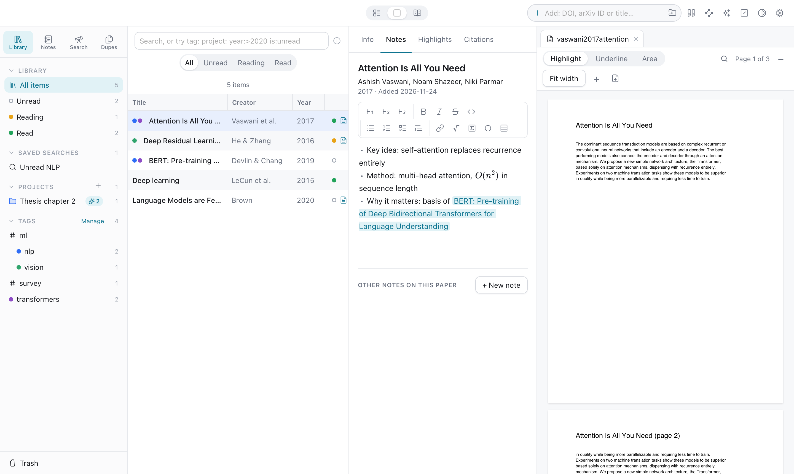
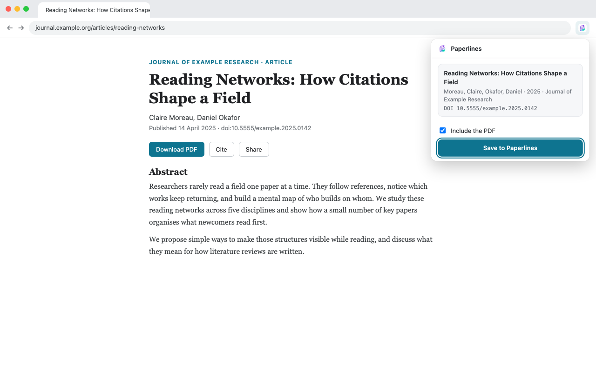
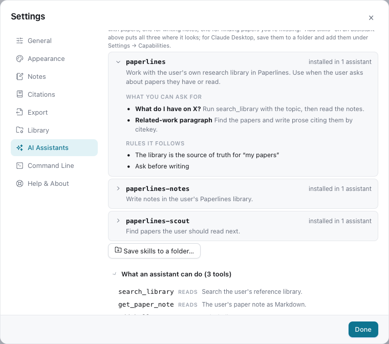

<div align="center">


<h1>Paperlines<br />&#8203;<sup><sub><em>Nanos gigantum humeris insidentes</em></sub></sup></h1>

**論文、ノート、そして論文どうしの引用関係を、ひとつのローカルアプリで。**

macOS、Windows、Linux 向けの無料・オープンソースの文献管理ソフトです。論文、ノート、そして論文どうしの引用関係を描く生きたマップを、あなたのコンピュータ上の 1 つのアプリにまとめました。

<!-- the release workflow points these buttons at each new version -->
<a href="https://github.com/Paperlines/paperlines/releases/download/v0.1.5/Paperlines_0.1.5_aarch64.dmg"></a> <a href="https://github.com/Paperlines/paperlines/releases/download/v0.1.5/Paperlines_0.1.5_x64-setup.exe"></a> <a href="https://github.com/Paperlines/paperlines/releases/download/v0.1.5/Paperlines_0.1.5_amd64.AppImage"></a>

[](https://github.com/Paperlines/paperlines/releases/latest) [](https://github.com/Paperlines/paperlines/releases) [](https://github.com/Paperlines/paperlines/actions/workflows/ci.yml) [](../../LICENSE) [](https://github.com/Paperlines/paperlines/commits/main) [](https://github.com/Paperlines/paperlines/stargazers)

[**ダウンロード**](#download) · [機能](#why-paperlines) · [コマンドラインと MCP](#command-line-and-ai-assistants) · [よくある質問](#questions-people-ask) · [コントリビュート](../../.github/CONTRIBUTING.md)

無料 · オープンソース · アカウント不要 · クラウドなし · テレメトリなし

[English](../../README.md) · [Español](README.es.md) · [Français](README.fr.md) · [Deutsch](README.de.md) · [简体中文](README.zh.md) · **日本語** · [हिन्दी](README.hi.md)

</div>

<p align="center">
  <picture>
    <source media="(prefers-color-scheme: dark)" srcset="../assets/readme/hero-dark.png" />
    
  </picture>
</p>

<a id="why-paperlines"></a>

## Paperlines を選ぶ理由

研究のための読書は、文献管理ソフト、ノートアプリ、そして PDF の山という 3 つの場所で同時に進みます。Paperlines はそれらを、ご自分のコンピュータ上のひとつのウィンドウにまとめます。

- **集める。** PDF、EPUB、フォルダごとドロップしたり、DOI、arXiv ID、PubMed ID を貼り付けたり、BibTeX、RIS、CSL-JSON、Zotero ライブラリをインポートしたりできます。メタデータは Crossref と OpenAlex から補完され、保存前にすべてを確認できます。
- **読んで注釈する。** 高速な PDF リーダーで、意味を持たせた色（重要なアイデア、手法、反対意見…）のハイライト、下線、範囲選択ができます。「ノートに引用」でハイライトをノートに挿入し、該当ページへのリンクも付きます。
- **リンクするノートを書く。** すべての論文にノートがあり、自由なノートやプロジェクトノートも作れます。`[[links]]`、`@citekey` による引用、バックリンク、表、LaTeX 数式を備えた Markdown で、入力しながら表示されます。
- **論文のつながりを見る。** 参考文献リストは一度取得してキャッシュされます。引用グラフは*あなたの*論文のどれがどれを引用しているかを示し、論文を追加するたびにオフラインで更新されます。
- **どこでも引用。** 約 80 の引用スタイル、LaTeX 用に常に最新に保たれる BibTeX ファイル、ライブラリ全体を 1 つのフォルダにまとめる書き出しなど、あらゆる形式で書き出せます。
- **あなたのもの。** 1 つの SQLite ファイルと PDF を、お好きなフォルダに保存します。毎日のバックアップとワンクリック復元。あなたが求めた検索以外、コンピュータから外に出るものはありません。

## 考えるための引用グラフ

<p align="center">
  
</p>

- 論文が力学レイアウトの中で動きます。1 つをドラッグすると隣接する論文がついてきて、ホバーするとその論文が引用している論文（青）と、その論文を引用している論文（オレンジ）が強調されます。
- 塗りはプロジェクトの色、枠線は読書状況。年、タグ、プロジェクト、読書状況でのフィルタと、1 つの論文を中心にしたローカルグラフがあります。
- **重要論文（スパイン）：** プロジェクトの土台となる論文をステップごとに指定します。**ツリー**レイアウトはそこから分野全体を広げ、**円形**はすべてをプロジェクトと年でグループ化します。
- **種類付きの関係**をあなた自身の判断で記録：ある論文が別の論文を*発展させる*、*反論する*、*再現する*、*その手法を応用する*など。メモと根拠となるハイライトを添えられます。

## 次に読む論文を見つける

<p align="center">
  
</p>

- **この論文を引用している論文：** どの論文についても、OpenAlex 全体から、その論文を引用している被引用数上位 2,000 件を表示します。**つながりの多い順**に並べると、ライブラリ内のほかの論文も引用している論文がわかります。たいてい次に読むのに最適な論文です。
- **オンライン検索**で OpenAlex、Semantic Scholar、arXiv、PubMed、Crossref、Europe PMC、DataCite、DOAJ を一度に検索し、1 つのリストにまとめて、すでに持っている論文には印を付けます。すべて無料です。
- 重複は、ノートやハイライトを失うことなく検出・統合されます。

## ブラウザから論文を保存

<p align="center">
  <a href="https://chromewebstore.google.com/detail/paperlines/ooldfogehieegmochobljichkajignkf"></a>
</p>

- **論文ページからワンクリック：**ジャーナルのページ、arXiv、PubMed、DOI リンクで、Paperlines ボタンが見つけた論文（タイトル、著者、年、誌名、識別子）を表示し、PDF と一緒に保存します。
- **ライブラリを把握：**すでにある論文はそう知らせます。PDF のない論文には、重複ではなく PDF が追加されます。
- **購読も使えます：**PDF はご自身のブラウザのログインでダウンロードされます。
- **プライバシー重視：**クリックしたときだけページを読み、見つけた情報はサーバーではなくお使いのコンピュータの Paperlines に渡します。アプリを閉じていても動作します。
- **対応ブラウザ：** Google Chrome、Microsoft Edge、Brave、Arc、Vivaldi、Chromium。

**👉 [Paperlines をブラウザに追加](https://chromewebstore.google.com/detail/paperlines/ooldfogehieegmochobljichkajignkf)**し、アプリの **設定 → ブラウザ拡張機能** で **接続** をクリックしてください。

## お手持ちの AI アシスタントを使う

<p align="center">
  
</p>

- **アシスタントパネル（⌘J）：** 開いている論文、PDF、ノートについて、ご自身の Claude Code や Codex とチャットできます。編集を許可するまでは読み取り専用で、加えた変更はすべて表示されます。
- 組み込みの MCP サーバーを通じて、Claude Code、Claude Desktop、Codex、Antigravity、Gemini CLI、Grok、Cursor に**ワンクリックで接続**。3 つのスキル付き：論文の扱い、構造化された論文ノートの作成（各ポイントを PDF 内のハイライトにリンク）、足りない論文の探索です。
- 提案はプロジェクトの**提案された論文**の受信箱に届きます。あなたがクリックしない限り、ライブラリには何も入りません。

<a id="download"></a>

## ダウンロード

<!-- the release workflow updates these links to each new version -->
| プラットフォーム | インストーラ | その他の形式 |
| --- | --- | --- |
| **macOS**、Apple Silicon（M1 以降） | [Paperlines_0.1.5_aarch64.dmg](https://github.com/Paperlines/paperlines/releases/download/v0.1.5/Paperlines_0.1.5_aarch64.dmg) | [.pkg](https://github.com/Paperlines/paperlines/releases/download/v0.1.5/Paperlines_0.1.5_aarch64.pkg) |
| **macOS**、Intel | [Paperlines_0.1.5_x64.dmg](https://github.com/Paperlines/paperlines/releases/download/v0.1.5/Paperlines_0.1.5_x64.dmg) | [.pkg](https://github.com/Paperlines/paperlines/releases/download/v0.1.5/Paperlines_0.1.5_x64.pkg) |
| **Windows** 10/11、x64 | [Paperlines_0.1.5_x64-setup.exe](https://github.com/Paperlines/paperlines/releases/download/v0.1.5/Paperlines_0.1.5_x64-setup.exe)（管理者権限不要） | [.msi](https://github.com/Paperlines/paperlines/releases/download/v0.1.5/Paperlines_0.1.5_x64_en-US.msi) |
| **Linux**、x86_64 | [Paperlines_0.1.5_amd64.AppImage](https://github.com/Paperlines/paperlines/releases/download/v0.1.5/Paperlines_0.1.5_amd64.AppImage) | [.deb](https://github.com/Paperlines/paperlines/releases/download/v0.1.5/Paperlines_0.1.5_amd64.deb) · [.rpm](https://github.com/Paperlines/paperlines/releases/download/v0.1.5/Paperlines-0.1.5-1.x86_64.rpm) · [CLI](https://github.com/Paperlines/paperlines/releases/download/v0.1.5/paperlines-x86_64-unknown-linux-gnu) |
| **Linux**、aarch64 | [Paperlines_0.1.5_aarch64.AppImage](https://github.com/Paperlines/paperlines/releases/download/v0.1.5/Paperlines_0.1.5_aarch64.AppImage) | [.deb](https://github.com/Paperlines/paperlines/releases/download/v0.1.5/Paperlines_0.1.5_arm64.deb) · [.rpm](https://github.com/Paperlines/paperlines/releases/download/v0.1.5/Paperlines-0.1.5-1.aarch64.rpm) · [CLI](https://github.com/Paperlines/paperlines/releases/download/v0.1.5/paperlines-aarch64-unknown-linux-gnu) |
| **NixOS** | `nix profile install github:Paperlines/paperlines` | 下の注意事項を参照 |

すべてのファイルは[リリースページ](https://github.com/Paperlines/paperlines/releases/latest)にあります。Linux パッケージには glibc 2.35 以降が必要です（Ubuntu 22.04、Debian 12、Fedora 36 以降）。

**ブラウザ拡張機能（Chrome、Edge、Brave、Arc、Vivaldi）：**読んでいる論文とその PDF をワンクリックで保存できます。[Chrome ウェブストアから追加](https://chromewebstore.google.com/detail/paperlines/ooldfogehieegmochobljichkajignkf)し、アプリの **設定 → ブラウザ拡張機能** で **接続** をクリックしてください。ストアのないブラウザ向けに [.zip](https://github.com/Paperlines/paperlines/releases/latest/download/paperlines-browser-extension.zip) もあります。

### アプリ内からのアップデート

<p align="center">
  
</p>

新しいバージョンが出ると、Paperlines は次に起動したときにお知らせします：新機能、携わった人、そして**今すぐ更新**か**後で**。アップデートは署名されており、インストール前に検証されます。macOS アプリ、Windows インストーラ、AppImage は自動で更新されます。`.deb`、`.rpm`、Nix でのインストールは各パッケージマネージャで更新します。確認は 設定 → 一般 でオフにでき、オフラインモードでは確認しません。

<details>
<summary>プラットフォームごとの注意事項：macOS インストーラ、Linux、NixOS、COSMIC/Wayland</summary>

**macOS インストーラ。** `.pkg` を開いて手順に従ってください。Paperlines を「アプリケーション」に、`paperlines` コマンドを `/usr/local/bin` にインストールします。アンインストールするには、アプリと `/usr/local/bin/paperlines` を削除します。ライブラリはそのまま残ります。

**Windows で初めて開くとき。** 「Windows によって PC が保護されました」と表示されたら、**詳細情報 → 実行**をクリックしてください。署名付きの Windows 版も準備中です（[コード署名ポリシー](../code-signing.md)）。

**Linux。** `.deb` と `.rpm` パッケージは CLI を `paperlines` としてインストールします。AppImage の場合は、別ファイルの `paperlines-<triple>` を PATH に置くか、**設定 → コマンドライン → コマンドラインツールをインストール** を使ってください。

**NixOS。** リポジトリは、アプリと CLI をソースからビルドする flake です（x86_64 と aarch64）：

```sh
nix run github:Paperlines/paperlines            # try it
nix profile install github:Paperlines/paperlines
```

NixOS または home-manager の設定では、flake を input として追加し、その overlay を使います：

```nix
nixpkgs.overlays = [ inputs.paperlines.overlays.default ];
environment.systemPackages = [ pkgs.paperlines ];   # or home.packages
```

これでアプリがデスクトップエントリとアイコン、`paperlines` コマンドとともにインストールされます。注意：
- API キーは Secret Service に保存されます。いずれかを有効にしてください（`services.gnome.gnome-keyring.enable = true;` または KeePassXC）。ない場合は、代わりに暗号化ファイルに保存されます。
- AppImage は NixOS ではそのままでは動きません。flake（または `appimage-run`）を使ってください。

**COSMIC（およびその他の Wayland デスクトップ）。** COSMIC 向けにビルドしていますが、まだ実機で検証していないため、報告を歓迎します：
- ライト／ダークはデスクトップの設定に従います（COSMIC、GNOME、KDE が使う XDG デスクトップポータルから読み取ります）。アプリを開いたままの切り替えにも対応します。設定の**システム**テーマがこれにあたります。
- ウィンドウには正しいアプリ ID があるため、ドックに正しいアイコンが表示され、ランチャーとウィンドウがまとめられます。
- Wayland 上の NVIDIA ドライバでは、WebKitGTK の DMA-BUF レンダラが自動的に無効になります（そこでは空白のウィンドウが表示されるため）。有効のままにするには `WEBKIT_DISABLE_DMABUF_RENDERER=0` を設定してください。
- ファイルダイアログは GTK のものです。ウィンドウにはシステムのタイトルバーやメニューバーはありません。Paperlines 独自のトップバーにウィンドウボタンがあり、トップバーをドラッグしてウィンドウを移動します。

</details>

<a id="command-line-and-ai-assistants"></a>

## コマンドラインと AI アシスタント

`paperlines` コマンドは、アプリと同じライブラリを扱います。macOS の `.pkg` でインストールされます。それ以外の環境では **設定 → コマンドライン → コマンドラインツールをインストール** を使ってください。

<details>
<summary>コマンド</summary>

macOS の `.pkg` なら自動でインストールされます。それ以外は **設定 → コマンドライン → コマンドラインツールをインストール** を使ってください。macOS では、アプリに同梱された CLI を `~/.local/bin/paperlines` にリンクします。その後：

```sh
paperlines search 'tag:ml year:>=2020 attention'
paperlines show vaswani2017attention          # metadata, counts and the paper note
paperlines note devlin2019bert --add 'Masked LM pre-training'
paperlines cites devlin2019bert               # library papers it cites (also: cited-by)
paperlines add paper.pdf 10.1038/nature14539 refs.bib --fetch-refs
paperlines export -f bibtex --project Thesis -o thesis.bib
paperlines export-notes ~/notes-export
paperlines fetch-refs                         # every paper without a reference list
paperlines doctor [--fix]                     # integrity, files, edges, search index
paperlines backup [--list | --restore FILE --yes]
paperlines cite vaswani2017attention --style ieee   # -b for a reference list; `paperlines styles` lists styles
paperlines rm KEY... / paperlines trash [list | restore KEY... | empty [--older-than DAYS]]
paperlines citing vaswani2017attention -s connected   # papers anywhere citing it (also: cited, newest)
paperlines relate chen2022 extends smith2021 --note "same loss"   # also: unrelate, relations [KEY], relation-types
paperlines duplicates [--merge | --dismiss]
paperlines find-pdf [KEY...]                  # open-access PDFs via OpenAlex
paperlines import-zotero [~/Zotero] / paperlines import-dump library.json
paperlines auto-export add -f bibtex thesis.bib [--project Thesis]
paperlines paths [--set-library DIR]
```

すべてのコマンドで `--json` が使えます。`--library DIR` または `PAPERLINES_LIBRARY=DIR` で別のライブラリを指定できます。CLI、アプリ、MCP サーバーは同じ実装（`crates/ops`）を共有しているため、結果は同一です。

</details>

<details>
<summary>Claude Code、Claude Desktop などのための MCP サーバー</summary>

```sh
claude mcp add paperlines -- paperlines mcp
```

Claude Desktop の場合は、`claude_desktop_config.json` に次を追加します：

```json
{ "mcpServers": { "paperlines": { "command": "paperlines", "args": ["mcp"] } } }
```

ツール：`search_library`、`get_item`、`get_paper_note`、`list_citations`、`find_citing_papers`、`list_relations`、`export_bibliography`（すべて読み取り専用。`find_citing_papers` は結果がキャッシュされていない場合にネットワークを使います）、`add_bullet`（論文ノートに箇条書きを 1 つ追記）、`add_relation`（ユーザーが求めた種類付きの関係を記録）。サーバーは stdin と stdout でのみ通信します。

</details>

<a id="questions-people-ask"></a>

## よくある質問

<details>
<summary>アカウントは必要ですか？クラウドに何か送られますか？</summary>

アカウントもクラウドもテレメトリもありません。ライブラリはあなたのコンピュータ上のフォルダです。ネットワークへの接続は、論文を追加したときや求めたときのメタデータ、参考文献、被引用論文の検索（Crossref、OpenAlex、Semantic Scholar、arXiv）で DOI などの識別子を送るものと、アプリの起動時に新しいバージョンが出ているかを確認するための GitHub への 1 回のリクエストだけです。**設定 → オフラインモード** で、これらすべてをオフにできます。

</details>

<details>
<summary>Zotero から移行できますか？</summary>

はい。**追加 → Zotero からインポート** で、論文を PDF、コレクション（プロジェクトとして）、タグ、ノート、ハイライトとともに取り込めます。Zotero のデータベースは先にコピーされ、変更されることはないため、両方を使い続けられます。

</details>

<details>
<summary>データはどこにあり、どうバックアップしますか？</summary>

| | macOS | Linux |
| --- | --- | --- |
| ライブラリ（データベース、`pdfs/`、`backups/`。**設定 → ライブラリ** で移動可能） | `~/Library/Application Support/Paperlines/` | `$XDG_DATA_HOME/paperlines/`（既定は `~/.local/share/paperlines/`） |
| 設定（API キーの代替保存先） | `~/Library/Application Support/Paperlines/` | `$XDG_CONFIG_HOME/paperlines/` |
| キャッシュ | `~/Library/Caches/Paperlines/` | `$XDG_CACHE_HOME/paperlines/` |

- **ライブラリ**は 1 つの SQLite ファイル（WAL、FTS5）と、内容のハッシュで保存された PDF からなります。元のファイルはコピーして取り込まれ、変更されることはありません。
- **クラウドフォルダ。** ライブラリを iCloud Drive や Dropbox に置く場合は、同期の前にアプリを終了してください。開いている SQLite データベースをクラウドクライアントに同期させてはいけません。
- **API キー。** キー（Semantic Scholar と OpenAlex、どちらも任意）は macOS のキーチェーンまたは Linux の Secret Service に保存されます。Secret Service がない場合は、設定フォルダ内の暗号化ファイルに保存されます。

バックアップは毎日、およびアップグレードの前に作成されます。**設定 → ライブラリ** からワンクリックで復元でき、ターミナルからは `paperlines backup` で同じことができます。

</details>

<details>
<summary>LaTeX で使えますか？</summary>

はい。約 80 のスタイルで引用をコピーでき、BibTeX、CSL-JSON、RIS で書き出せます。**このファイルを常に最新に保つ** を使えば、Better BibTeX のように、ライブラリが変わるたびに `.bib` ファイルが書き直されます。

</details>

<details>
<summary>Paperlines でできることのすべて</summary>

- **ライブラリ。** PDF、EPUB、フォルダをドロップするか、DOI、arXiv ID、BibTeX、RIS、CSL-JSON ファイルから論文を追加します。Zotero と同じく、各ファイルはファイル名ではなくタイトルと著者で一覧表示されます。メタデータはファイル（PDF の情報、EPUB のパッケージデータ）から取得し、Crossref または OpenAlex で補完します。DOI のない PDF は 1 ページ目のテキストで照合します。保存前にすべてを確認できます。ライブラリは並べ替え可能な表（タイトル、作成者、年、追加日）で、Zotero と同様の項目をすべて編集できます：巻、号、ページ、出版社、出版地、ISBN/ISSN、版、シリーズ、編者。
- **Zotero からインポート。** 論文を PDF、コレクション（プロジェクトとして）、タグ、ノート、ハイライトとともに取り込みます。Zotero のデータベースは先にコピーされ、変更されることはありません。このアプリの JSON ダンプもインポートできます。
- **重複とゴミ箱。** 重複ビューでは、PDF が同じ論文や、同じ年でタイトルがほぼ同じ論文を見つけます。すべてのノート、ハイライト、タグ、ファイルを保ったまま 1 つに統合できます。削除すると論文はゴミ箱に移動し（元に戻すことも可能）、30 日後（変更可能）に自動で空になります。
- **検索。** 全文検索の対象はタイトル、著者、要旨、ノート、ハイライトで、修飾子が使えます：`tag:ml/nlp project:"Thesis" author:hinton year:>=2020 is:unread has:pdf cites:<citekey> cited-by:<citekey>`。`-` で語を除外できます。検索は保存できます。
- **整理。** 色付きの階層タグ（名前変更と統合が可能）、プロジェクト、読書状況、評価、そしてコマンドパレット（⌘K / Ctrl+K）。
- **読む。** PDF.js ベースのリーダーで、ハイライト、下線、範囲選択ができます。ハイライトの色には意味があります（黄 = 重要なアイデア、など）。「ノートに引用」はハイライトを論文ノートにコピーし、該当ページへのリンクを付けます。「注釈付き PDF を書き出す」はコピーを書き出し、元のファイルは変更しません。
- **クイック追加。** トップバーの入力欄に DOI、arXiv ID、PubMed ID、またはタイトルを貼り付けて Enter を押すと、確認してから追加できます。欄の端にあるボタンからは、ほかの追加方法（ファイル、フォルダ、BibTeX、Zotero、ライブラリの書き出しデータ、オンライン検索）を選べます。
- **論文ノート。** すべての論文に 1 つのノートがあります。ヘッダー（タイトル、著者、日付）は論文から生成され、本文はあなたの箇条書きです。ノートは Markdown で、ほかのノートや論文への `[[links]]`（`[[` と入力すると候補が表示され、一致するものがなければ新しいノートを提案し、リンクをたどるとノートが作成されます）、`@citekey`、数式、バックリンクが使えます。数式は LaTeX で、インラインは `$…$`、中央揃えの数式は `$$…$$`（複数行も可）で書き、KaTeX で表示されます。数式の中で `\` と入力するとコマンドが記号付きで補完され（`\al` → `\alpha` α）、エディタのツールバーにはタイトルと見出し、太字、斜体、取り消し線、コード、箇条書き・番号付き・チェックリスト、引用（ショートカット：⌘B、⌘I、⌘E、⌘⇧X、⌘⇧8/7/9、⌘⌥1–3。各ボタンはオン／オフを切り替え、Enter でリストが続きます）、リンクボタン、インライン数式と数式ブロックのボタン、そしてギリシャ文字、演算子、関係、矢印、集合と論理の記号、アクセントを集めた **Ω** パレットがあります。ライブプレビューでは、編集中の箇所を除いて Markdown と数式が入力しながら表示されます。自由なノートやプロジェクトノートも同じように使えます。
- **オンライン検索。** OpenAlex、Semantic Scholar、arXiv、PubMed、Crossref、Europe PMC（生命科学、無料の全文あり）、DataCite（データセット、ソフトウェア、プレプリント）、DOAJ（オープンアクセスジャーナル）を一度に検索し、1 つのランク付きリストにまとめます。情報源のオン／オフを切り替え、すでに持っている論文を確認し、結果をプロジェクトのグラフとしてマップできます。すべて無料で、任意のキーを使えるのは OpenAlex と Semantic Scholar だけです。
- **引用グラフ。** 参考文献リストは一度だけ取得され（OpenAlex、次に Semantic Scholar、またはご自身の GROBID サーバー）、キャッシュされます。オープンな引用インデックスである OpenCitations が、それらで漏れた参考文献を補い、どちらにも載っていない論文の代わりも務めます。グラフに表示されるのはライブラリ内の論文だけです。あとから追加した論文は、キャッシュからオフラインでリンクされます。リンクは手動で追加・削除でき、再計算してもその判断は保たれます。
- **グラフビュー。** 論文は筆頭著者と年（「Smith ’21」）をラベルにした角丸のボックス、またはドットで表示されます。力学レイアウトがリアルタイムで動き、論文が浮かんで落ち着き、1 つをドラッグすると隣接する論文も引っ張られ、ズームするとラベルが現れ、ホバーするとその論文の引用（青：引用している、オレンジ：引用されている）が強調されて残りが薄くなります。論文はプロジェクトの色で塗られ、枠線は読書状況を表します。選択とキーボードフォーカスはボックスの周りに輪郭線を描き、キャンバス上の小さな凡例が色の意味を示します。歯車アイコンでグラフの設定をグラフの横に表示します（ペインが狭い場合はまず広げます）：**フィルタ**（検索、リンクのない論文、年、タグ、プロジェクト、読書状況、選択した論文を中心にしたローカルグラフ）、**グループ**（プロジェクト・タグ・読書状況による色分け、状況リング、凡例）、**表示**（ボックスかドット、力学または年順レイアウト、ラベル、矢印、テキストのフェード、ノードのサイズ、リンクの太さ、全体図）、**力**（中心力、反発力、リンク力、リンクの距離）。論文にホバーするとノートカードが表示され、クリックで固定して編集、ダブルクリックまたは Enter で PDF が開きます。
- **種類付きの関係。** 論文どうしの関係をあなたの判断で記録します：ある論文が別の論文を*発展させる*、*反論する*、*再現する*、*その手法を応用する*、または独自に定義した種類（例：*支持する* / *支持される*）。それぞれの関係はどちらの論文から見ても正しく読め（「発展させる」/「発展させられた」）、メモと根拠となる PDF のハイライトを添えられ、グラフでは種類で絞り込める色付き・ラベル付きのリンクとして表示されます。論文の「引用」タブ、右クリックメニュー、⌘K、またはグラフで ⌥ を押しながら論文から別の論文へドラッグして追加します。`paperlines relate chen2022 extends smith2021` や、MCP ツールの `list_relations` / `add_relation` でも追加できます。
- **この論文を引用している論文。** DOI または arXiv ID のある論文なら、OpenAlex 全体（予備として Semantic Scholar）から、誰がその論文を引用しているかがわかります。被引用数上位 2,000 件を、被引用数、日付、または**つながりの多い順**で並べ替えられます。最後のものは、ライブラリ内のほかの論文も引用している論文を先に出す並べ方で、たいてい次に読むのに最適な論文です。絞り込み、ライブラリにすでにある論文の確認、欲しい論文のインポート確認経由での追加ができます。結果は 1 週間保持されます。`paperlines citing` と MCP サーバーでも同じことができます。
- **重要論文（スパイン）。** プロジェクトの土台となる論文を、最初のアイデア、次にそれを発展させた論文という順に、ステップごとに指定します。1 つのステップに複数の論文を入れられます（同時に同じ発見をした 2 つのグループなど）。プロジェクトのダイアログで作るか、論文を右クリック → *スパインに追加* で作ります。グラフでは重要論文がステップ番号（①、②…）付きのアンバー色のボックスとして描かれ、金色の線で結ばれます。これを使うレイアウトがさらに 2 つあります：**ツリー**はスパインから左から右へ広がり、各ステップは幹上の名前付きボックスとなり、ほかの論文は最も近い重要論文からぶら下がります。**円形**はすべての論文を 1 つの円に並べ、プロジェクトでグループ化して年順に並べます（150 件を超えるとドット表示）。`paperlines spine "Thesis" add smith2018 --step 1` でも操作できます。
- **アシスタントパネル。** ⌘J（またはアシスタントボタン）で、ご自身のアカウントでサインインしたご自身の **Claude Code** または **Codex** とのチャットが開くため、API キーの設定は不要です。パネルには 設定 ▸ AI アシスタント で接続したエージェントが表示され、ヘッダーから切り替えられます（切り替えると新しいチャットが始まります）。アシスタントが見られるのは Paperlines ライブラリだけで、MCP サーバーと同じツールを使います。開いている論文、PDF、ノートを把握し、それについての質問の例を提案します。手順は 1 行に折りたたまれて開くことができ、返答内の `@citekey` やハイライトへのリンクから論文やページが開きます。**編集可**に切り替えるまでは**読み取り専用**です。切り替えると、ノート、ハイライト、関係、提案を書き込めるようになり（削除はしません）、加えた変更はすべてチャットに表示されます。
- **外観。** 設定 ▸ 外観：テーマ、アクセントカラー（ティール、ブルー、バイオレット、グリーン、アンバー、ローズ）、レイアウト（サイドバーとアシスタントの位置：クラシック、反転、両方左、両方右）、細いまたは標準のアイコン、トップバーのアイコン下のラベル（任意）。
- **AI アシスタント。** 設定 → AI アシスタント で、組み込みの MCP サーバーを Claude Code、Claude Desktop、Codex、Antigravity、Gemini CLI、Grok、Cursor にワンクリックで接続し（各アシスタント自身の設定ファイルを編集するか、そのアシスタントの `mcp add` コマンドを使い、ほかの内容はそのまま保ちます）、3 つのスキルをインストールします：**paperlines**（論文の扱い）、**paperlines-notes**（「重要なアイデア / 手法 / 重要な理由」の形式、または論点ごとに論文ノートを書く。各論点の根拠となる文を、その意味に対応する色で PDF 内にハイライトし、ノートの各ポイントをそのハイライトにリンクします。プロジェクトのまとめや関連研究の下書きにも対応し、保存前に本文を見せて確認を求め、上書きは決してしません）、**paperlines-scout**（足りない論文の探索）。アシスタントはプロジェクトとライブラリの内容を把握し、論文の PDF を読み、引用することで箇所をハイライトし（次にその PDF を開いたとき、リーダーがページ上に配置します）、ノートの作成や追記ができます。アプリはウィンドウが前面に戻るたびに変更を反映します。次に読むべき論文を尋ねると、理由（プロジェクト内の複数の論文に引用されている、それらの複数を引用している、関連している、トピックに一致している）を添えて論文を提案し、プロジェクトの**提案された論文**の受信箱に入れます。そこで 1 件ずつ追加か却下を選べます。クリックしない限りライブラリには何も入らず、却下した論文は二度と提案されません。`paperlines suggest --project NAME [--topic …] [--post]` と `paperlines projects` もあります。
- **タブとレイアウト。** PDF、ノート、グラフはタブで開きます。レイアウトは 3 種類：ライブラリのみ、ライブラリとリーダー、リーダーのみ。
- **引用。** 約 80 の組み込み CSL スタイル（APA、Chicago、IEEE、Nature、Vancouver…）で、引用（⌘⇧C）や参考文献の項目（⌘⇧B）をコピーできます。Word や Google Docs にはリッチテキストとして貼り付けられます。**オープンアクセスの PDF を探す** は、OpenAlex を通じて合法なコピーを取得します。
- **書き出し。** BibTeX、CSL-JSON、RIS、Markdown の参考文献リスト、整形済み参考文献リスト（任意のスタイルの HTML）、Markdown ノートのフォルダ。**ライブラリ全体** は、`library.json` と `pdfs/` からなる 1 つのフォルダにすべてを書き出します：論文とその PDF、ノート、ハイライト、タグ、色と重要論文を含むプロジェクト、引用グラフ（手動で設定したリンクを含む）、根拠付きの種類付きの関係。**追加 ▸ ライブラリをインポート…** で別のライブラリに取り込めます（別のコンピュータでも、既存のライブラリへの統合でも可。すでにある論文はスキップされます）。`paperlines export-library DIR` と `paperlines import-dump FOLDER` でも同じことができます。**このファイルを常に最新に保つ** は、Better BibTeX のように、ライブラリが変わるたびに `.bib`（またはほかの）ファイルを書き直すため、LaTeX プロジェクトは常に最新の状態に保たれます。
- **必要な場所にヘルプ。** 設定内や、検索、ゴミ箱、重複の横にある ⓘ ボタンが、各オプションを説明します。
- **安全性。** ワンクリック復元付きの毎日のバックアップ、スキーマのアップグレード前のバックアップ、あらゆる場所でのトランザクション、そして `doctor`。
- **コマンドラインと MCP。** `paperlines` CLI と、Claude Code や Claude Desktop がライブラリを検索したり論文ノートに箇条書きを追加したりできる MCP サーバー。stdio 経由でローカルに動作し、ネットワーク上では動きません。

ネットワークへのアクセスは、論文を追加したときや求めたときだけのメタデータ、参考文献、被引用論文の検索（Crossref、OpenAlex、Semantic Scholar、arXiv）と、アプリの起動時に新しいバージョンが出ているかを確認する GitHub への 1 回のリクエスト（設定 → 一般 でオフにできます）だけです。送信されるのは識別子（DOI、arXiv ID）だけです。無料の OpenAlex API キー（設定 → 引用）があれば、ご自身専用の 1 日の上限を使えます。ない場合、検索はネットワーク全体で共有される少ない上限内で行われます。**設定 → オフラインモード** で、これらすべてをオフにできます。

</details>

## ソースからビルド

前提条件：

- Node 26 以上、pnpm 12.21（正確なバージョンは `package.json` に記載）、rustup 経由の Rust（バージョンは `rust-toolchain.toml` で固定）
- **macOS：** Xcode Command Line Tools（`xcode-select --install`）
- **Debian/Ubuntu：** `sudo apt install libwebkit2gtk-4.1-dev libgtk-3-dev libayatana-appindicator3-dev librsvg2-dev libsecret-1-dev patchelf build-essential curl file`
- **Fedora：** `sudo dnf install webkit2gtk4.1-devel gtk3-devel libappindicator-gtk3-devel librsvg2-devel libsecret-devel openssl-devel`
- **Arch：** `sudo pacman -S webkit2gtk-4.1 gtk3 libappindicator-gtk3 librsvg libsecret base-devel`

```sh
pnpm install
pnpm tauri dev        # run the app (builds the CLI sidecar first)
pnpm tauri build      # macOS: .app + .dmg; Linux: .deb, .rpm, AppImage
pnpm build:pkg        # macOS: the .pkg installer, from the .app built above
```

macOS のユニバーサルビルドを作るには、`rustup target add x86_64-apple-darwin aarch64-apple-darwin` を実行してから `pnpm tauri build --target universal-apple-darwin` を実行します。

チェック、アーキテクチャ、規約については [docs/development.md](../development.md) と [docs/architecture.md](../architecture.md) を参照してください。

## さらに詳しく

- [新機能](../CHANGELOG.md)：各バージョンの変更点
- [開発](../development.md)：チェック、リリース、署名、Nix、Windows、名前の変更
- [アーキテクチャ](../architecture.md)：コードの構成とその理由
- [コントリビュート](../../.github/CONTRIBUTING.md)：協力の方法

## コミュニティ

バグ報告、アイデア、プルリクエストを歓迎します：[Issue を作成する](https://github.com/Paperlines/paperlines/issues)か、[CONTRIBUTING.md](../../.github/CONTRIBUTING.md) を読んで始めてください。これまで貢献してくださったすべての方に感謝します：

<a href="https://github.com/Paperlines/paperlines/graphs/contributors"></a>

Paperlines が研究のお役に立っていたら、GitHub で ⭐ を付けていただくと、ほかの研究者が見つけやすくなります。

## Paperlines を引用する

<details>
<summary>BibTeX</summary>

```bibtex
@software{paperlines,
  author  = {{The Paperlines contributors} and Yoav Yosif-Or},
  title   = {{Paperlines}: a local-first reference manager},
  year    = {2026},
  url     = {https://github.com/Paperlines/paperlines},
  license = {AGPL-3.0-or-later}
}
```

アプリの **ヘルプと情報 → 論文で Paperlines を引用** から、正確なバージョンを含むエントリと APA 形式を取得できます。

</details>

## ライセンス

Copyright © 2026 the Paperlines contributors and Yoav Yosif-Or. Paperlines は [GNU Affero General Public License v3.0 以降](../../LICENSE)のもとで提供されるフリーソフトウェアです。使用、研究、共有、改変は自由ですが、改変版を配布する場合（ネットワークサービスとして提供する場合を含む）は、同じライセンスのもとで変更内容を公開する必要があります。

<sub>Claude、Codex、Gemini、Antigravity、Grok、Cursor は、それぞれの所有者の商標です。これらの名前とアイコンは、Paperlines が連携できるツールを示すためにのみ表示しており、各社による推奨を意味するものではありません。アシスタントのアイコンは [Lobe Icons](https://github.com/lobehub/lobe-icons)（MIT ライセンス、`src/assets/agents/LICENSE-lobe-icons.txt` を参照）のものです。</sub>

---

<p align="center">
  制作：<a href="https://github.com/yoav-yosifor"><strong>Yoav Yosif-Or</strong></a>
</p>
